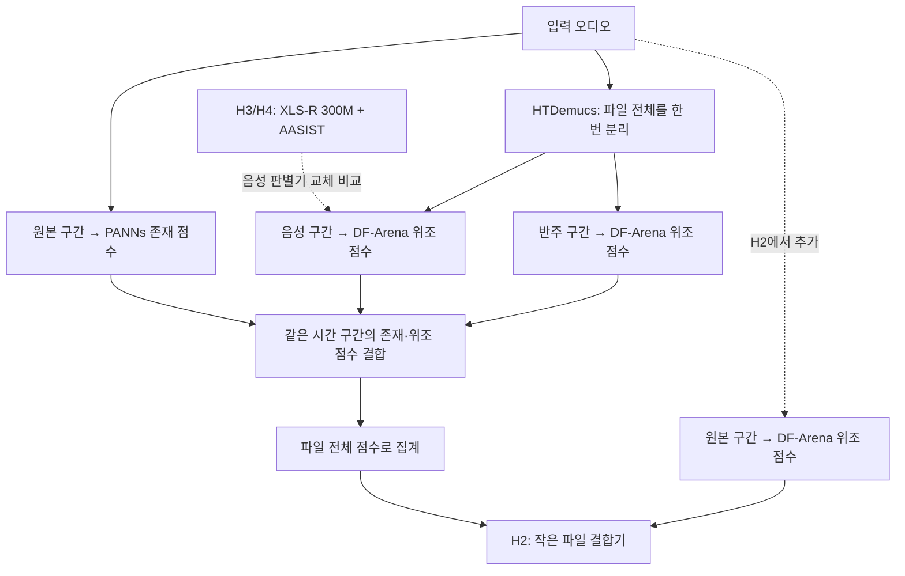

# Superseded by V6 implementation (2026-09-15)
The user authorized building the complete combined configuration and subsequently
authorized operating their paused H100 workspace through Computer Use, uploading
an experiment notebook/data, and training with widely spaced progress checks.
Use `V6_FINAL_README.md` and `V6_H100_Experiment.ipynb`. The historical H0–H4
sequence below is no longer the execution plan. No additional approval to start
the already authorized trial is needed. Verify the live balance and hourly price
before setting the notebook's bounded budget. Computer Use is currently blocked
by missing temporary-file errors; the GPU has not been resumed by this task.

---

---
slug: vessl-h100-dacon-training
status: design-ready-not-implemented
updated: 2026-09-15
approach: frozen official baseline, aligned segment scoring, small file fusion, one alternative speech checkpoint
budget: first trial within a proposed 20 USD top-up; previous overall ceiling remains 50 USD
---

# H100 1장·첫 $20 시험 파이프라인

2026-09-15 수정. 기존 50크레딧 장기 학습안을 첫 $20 비교 실험으로 재구성했다. 목표는 중간 처리 변경과 사전학습 가중치 교체 중 어디에 추가 학습 비용을 쓸지 판단하는 것이다. 이 문서는 설계이며 신규 실행 코드, 가중치 다운로드, 충전, GPU 생성, 학습, 제출은 이번 수정에서 실행하지 않았다. 리더보드 7위권은 장기 목표이며 이번 실험의 성공 조건은 아니다.

## 1. 이번에 고정할 구조

공식 베이스라인의 PANNs Cnn14, HTDemucs, DF-Arena 1B 원본 가중치에서 시작한다. B1/B2에서 미세조정한 가중치를 초기값으로 사용하지 않는다. 음악 기본 판별기도 공식 베이스라인과 같은 DF-Arena다. SONICS는 이미 B1에 도입한 후보이므로 새로운 가중치 교체의 성과로 다시 세지 않는다.



점선은 비교 후보에서만 활성화한다. 최종 제출물에 모든 분기를 합치는 구조가 아니다. DF-Arena는 같은 모델을 원본·음성·반주에 재사용한다. 음악 분기의 DF-Arena를 사용하는 한 음성 모델을 교체해도 DF-Arena 전체를 제거할 수는 없다.

## 2. 시간 구간과 출력 계약

- 구간은 공식 코드와 같은 16 kHz, 64,600샘플(4.0375초)이다. 마지막 구간과 짧은 파일 반복 채우기도 공식 `get_segment_starts`와 `extract_segment`를 재사용한다. 첫 비교에서 길이·stride·집계 규칙을 함께 바꾸지 않는다.
- HTDemucs로 파일 전체를 한 번 분리한 후 원본·음성·반주에 같은 시작 시각을 적용한다. 리샘플링 후 길이를 확인하고 구간 ID와 유효 길이를 기록한다. 구간마다 다시 분리하지 않는다.
- PANNs에는 해당 원본 구간을 32 kHz로 변환해 넣는다. 원래 AudioSet 분류 출력과 `component_labels.json`의 클래스 집계를 유지하고 V5의 새 2출력 존재 분류기를 사용하지 않는다.
- `p_v[t], p_m[t]`는 구간별 존재 점수, `d_v[t], d_m[t]`는 분리 음성·반주의 위조 점수, `d_r[t]`는 원본의 위조 점수다. 원본 DF-Arena 점수를 곧바로 음성이나 음악의 정답 확률로 해석하지 않는다.
- 공식 무음 처리와 라벨 방향을 유지한다. 파형 정규화·패딩·정밀도를 바꾸면 별도 수치 비교를 남긴다.
- 출력은 `ID`와 기존 5개 확률 열을 유지한다. 파일 간 통계로 예측을 보정하지 않는다.

## 3. 비교 후보와 학습 범위

| 후보 | 변경점 | 학습하는 부분 | 비교 대상 |
|---|---|---|---|
| H0 | 공식 베이스라인 그대로 | 없음 | 기준 |
| H1 | 같은 구간 안에서 존재·위조 점수를 먼저 결합 | 없음 | H0 |
| H2 | H1에 원본 DF-Arena 점수와 파일 결합기 추가 | L2 정규화 로지스틱 회귀 1개 | H1 |
| H3 | H1의 음성 판별기를 공개 XLS-R+AASIST 탐지 가중치로 교체 | 없음 | H1 |
| H4 | H3의 음성 분류기만 제한적으로 미세조정 | 기존 최종 분류층 | H3 |

H0~H3가 우선 비교 대상이고 H4는 처리량·검증 품질·잔여 예산이 맞을 때 실행한다. H2와 H3를 동시에 적용한 조합, MERT, SONICS 재학습, B3/B4 Transformer, 여러 seed, 전체 backbone 장기 학습은 첫 시험에서 제외한다. MERT-v1-95M은 음악 오류가 주된 병목으로 확인될 때 다음 음악 실험 후보로 남긴다.

### H1: 같은 구간의 증거를 결합

```text
H0_FILE = max(max_t(p_v[t]) * max_t(d_v[t]),
              max_t(p_m[t]) * max_t(d_m[t]))
e_v = max_t(p_v[t] * d_v[t])
e_m = max_t(p_m[t] * d_m[t])
H1_FILE = max(e_v, e_m)
```

존재·위조 점수의 최고점이 서로 다른 구간에서 나오는 경우를 구분한다. H1의 나머지 4개 출력은 H0와 같다. 같은 구간 점수를 재사용하면 `H1_FILE <= H0_FILE`이지만 점수가 낮아지는 것 자체는 개선이 아니다. 파일 EER과 진짜/가짜별 점수 변화를 함께 확인한다. 상위 구간 평균·attention pooling은 이번 비교에 추가하지 않는다.

### H2: 파일 라벨로 작은 결합기 학습

```text
z = [e_v, e_m, max_t(d_r[t]),
     max_t(abs(d_r[t] - d_v[t])),
     max_t(abs(d_r[t] - d_m[t]))]
H2_FILE = sigmoid(w · z + b)
```

이 5개 특징에 L2 정규화 로지스틱 회귀를 적용한다. 기본 정규화 강도 C=1로 시작하며 첫 시험에서 강도 탐색은 하지 않는다. 입력은 확률 범위이므로 별도 표준화를 추가하지 않는다. 파일 단위 FILE 라벨로만 학습하고 파일 라벨을 모든 구간의 위조 라벨로 복사하지 않는다. 다른 4개 출력은 H1과 같다. 원본·분리 점수 차이는 보조 특징이며 분리 품질의 정답값으로 간주하지 않는다.

H2 대조로 `z=[e_v,e_m]`만 쓰는 같은 회귀도 계산한다. 추가 GPU 추론 없이 단순 점수 보정의 이득과 원본 경로의 추가 이득을 구분하는 비교다. 전체 H2가 이 대조보다 낫지 않으면 원본 경로의 효과가 입증됐다고 보고하지 않는다.

### H3/H4: 새 음성 가중치

- 저자 저장소 `TakHemlata/SSL_Anti-spoofing`에서 안내한 DF용 `best_SSL_model_DF.pth`와 필요한 XLS-R 300M 가중치를 첫 후보로 지정한다. 호환되는 원본 설정·전처리·실제 다운로드 파일의 SHA-256·라이선스를 확보한 뒤 사용한다. 공개 링크 안내는 확인했지만 현재 환경에서 다운로드와 복원 성공은 아직 확인하지 않았다.
- H3는 H1과 같은 분리 음성 구간을 사용해 모델 교체 효과만 비교한다. 구간 집계와 PANNs·음악 분기는 유지한다. 원본 클래스 순서를 확인해 출력 점수를 fake 방향으로 변환한다. 두 모델은 backbone과 backend가 다르므로 같은 구조에서 가중치만 바꾼 실험이라고 부르지 않는다.
- 원본 저장소의 구형 fairseq/Python/PyTorch 구성을 제출 환경에 그대로 설치하지 않는다. 유료 실행 전에 호환 로더를 준비하고 기준 구현과 같은 오디오의 점수를 비교한다. 호환성 또는 이용조건이 해결되지 않으면 H3/H4를 미실행으로 남기고 GPU 시간을 설치 디버깅에 소진하지 않는다.
- H4는 XLS-R와 AASIST 특징 추출 부분을 eval 모드로 고정하고 최종 분류층만 학습한다. H3와 같은 분리·구간 전처리로 특징을 한 번 추출해 재사용한다. 구간 정답이 알려진 음성만 사용하며 부분 위조 파일의 전체 라벨을 임의 구간에 복사하지 않는다. 이 조건을 만족하는 데이터가 없으면 H4를 건너뛴다.
- H4의 첫 에포크에서 학습·검증 시간을 측정한다. 최대 10에포크와 학습 배정 시간 중 먼저 도달하는 조건에서 종료하고 dev 최적 가중치를 선택한다. 첫 시험에서 60/90에포크나 전체 미세조정을 약속하지 않는다. 변경한 파라미터의 gradient와 실제 가중치 변화를 확인한다.

## 4. 데이터와 검증

구현 전에 출처·권리·화자·아티스트·생성기·혼합 부모·PCM 해시를 포함한 manifest를 확정한다. 동일 원본의 크롭·코덱 변형·혼합물은 같은 그룹에 둔다. 혼합물의 모든 부모가 같은 split에 있어야 한다.

네 그룹을 둔다: `expert_train`(H4), `fusion_train`(H2), `dev`(후보 선택), `holdout`(최종 1회 평가). H2의 탐지기는 고정된 공개 가중치만 쓰고 H4와 결합하지 않아 이번에는 OOF 계산을 요구하지 않는다. 각 그룹의 표본 수·라벨 범위는 manifest 감사 후 기록하며 숫자를 임의로 채우지 않는다.

기존 최종 재학습에 포함된 dev/sealed를 독립 검증이라고 부르지 않는다. 새 holdout은 이전 참가자 튜닝에 쓰이지 않은 원본으로 구성한다. upstream 사전학습 데이터까지 미노출이라는 보장은 하지 않는다. 모르는 라벨은 UNKNOWN으로 유지한다. 필요한 real/fake·presence 범위가 없으면 해당 지표 또는 학습 단계를 수행하지 않는다.

후보별로 같은 파일의 FILE/VOICE/MUSIC EER, 존재 AUC, 추론 시간과 peak VRAM을 보고한다. 공식 점수는 필요한 라벨이 모두 확보됐을 때만 계산한다. 부분 라벨만 있으면 coverage와 하위 지표를 따로 보고하고 공식 종합 성능 우위를 주장하지 않는다.

dev의 공식 종합 점수가 가장 좋은 후보를 우선하되 H0 대비 개선이 없으면 H0를 유지한다. 부분 라벨에서는 비교 가능한 공통 집합의 EER로 다음 실험 후보만 고른다. 선택을 고정한 뒤 holdout에서 한 번 확인하며, holdout 결과를 본 후 다른 후보를 반복 선택하지 않는다. 원본 그룹 단위 paired bootstrap으로 차이의 불확실성을 기록한다. 개선이 불명확하면 승리나 순위 상승으로 표현하지 않는다.

## 5. 공통 계산과 실행 순서

1. 로컬에서 데이터·가중치·환경·입출력을 준비한다. 기존 캐시는 데이터·가중치·전처리·구간·정밀도 해시가 모두 맞을 때만 재사용한다. bundled dummy 파일로 성능을 비교하지 않는다.
2. H100에서 짧은 실측으로 분리·탐지 처리량과 메모리를 측정한다. 전체 예정 데이터 처리와 마지막 검증이 예산에 들어가는지 계산한다. 초과하면 유료 실행을 멈추고 후보 수나 사전 등록한 데이터 범위를 줄인다. 결과를 보고 유리한 파일만 고르지 않는다.
3. HTDemucs 결과, 구간별 PANNs와 DF-Arena 점수를 한 번 저장한다. H0/H1은 같은 구간 점수로 계산한다. H0의 캐시 재구성이 공식 코드의 예측을 최대 절대 차이 `1e-4` 이내로 재현하는지 확인한다. 초과하면 허용오차를 늘리지 말고 전처리·정밀도·집계를 먼저 조사한다.
4. H2용 원본 점수와 H3용 음성 점수를 추가로 계산한다. 모델은 필요한 순서대로 올리고 내린다. 전 모델을 GPU에 동시에 상주시킬 필요가 없다.
5. H2와 그 대조 회귀는 저장된 특징으로 CPU에서 학습한다. 그동안 H100은 종료하거나 필요한 H3/H4 계산을 수행하며 대기시키지 않는다.
6. H4는 재개 가능한 model/optimizer/RNG/step/config 기록과 함께 수행한다. 남은 예산이 다음 에포크와 검증·저장에 부족하면 시작하지 않는다.
7. 선택된 후보를 holdout으로 평가하고 체크포인트·설정·예측·실행시간을 외부에 보존한다. 별도 경로에서 패키지의 오프라인 추론이 저장된 기준 예측을 최대 절대 차이 `1e-4` 이내로 재현하는지 확인한 뒤 GPU와 불필요한 스토리지를 정리한다.

## 6. $20 시험 예산

직전 계정 확인 시 잔액은 약 -$0.6165였다. $20 신규 충전 시 약 $19.38을 사용할 수 있다는 계산이며 현재 충전 완료를 뜻하지 않는다. 이번 $20은 앞서 말한 총 $50 한도 안의 첫 시험으로 취급한다. 나머지를 자동으로 충전하거나 사용하지 않는다.

계획 요금은 시간당 $3, 계산 작업 상한은 $15다. 공개 가격 $2.98/시간으로 5시간을 사용하면 약 $14.90이며 $4.48가량이 저장·종료 지연·복구 여유로 남는다. 기존 $2.39/시간 사용 이력은 이번 H100의 현재 요금으로 가정하지 않는다. 실제 시작 화면의 요금과 잔액으로 다시 계산한다.

| 단계 | 시간 배정 상한 | $3/시간 예산 |
|---|---:|---:|
| 환경·처리량·수치 재현 확인 | 30분 | $1.50 |
| 분리·기준 점수·원본 점수 캐시 | 90분 | $4.50 |
| 새 음성 가중치 H3 추론 비교 | 30분 | $1.50 |
| H4 제한 학습, 조건 충족 시 | 90분 | $4.50 |
| 최종 검증·저장·패키지 확인 | 60분 | $3.00 |
| 합계 | 최대 5시간 | 최대 $15.00 |

각 시간은 완료 시간 예측이 아니다. 계산 상한은 `min(5시간, $15 / 실제 시간당 요금)`이며 저장 비용 예상치가 예비비를 넘으면 더 낮춘다. 단계 간 시간은 최종 검증·저장 예산을 보존하는 범위에서만 옮긴다. 필요 없는 H4 시간은 소비하지 않는다.

배치 Job 종료와 실제 GPU 할당 해제를 확인한다. 학습 스크립트 종료나 잔액 0만 믿지 않는다. 결과 백업을 확인한 후 더 필요 없는 Cluster/Object 볼륨도 별도로 삭제하고 Billing의 비용 발생 속도·저장량을 확인한다. 자동 충전과 음수 버퍼 사용은 계획에 넣지 않는다.

## 7. 재사용할 코드와 구현할 부분

| 위치 | 재사용 또는 변경 범위 |
|---|---|
| `baseline_original/script.py` | 공식 가중치 로딩·분리·구간 분할·라벨 집계 기준. 원본 보존 |
| `v5_features.py` | 캐시·시간축 처리 패턴 재사용. 학습용 20초 문맥과 zero-padding을 공식 전체 파일 비교에 그대로 적용하지 않음 |
| `recovery_fusion.py` | 특정 출력만 교체하고 나머지를 보존하는 패턴 재사용. SONICS 공식 자체는 새 실험과 구분 |
| `graph_scoring.py` | 출력 계약·라벨 coverage·성분별 평가 재사용 |
| `v5_training.py`, `v5_final_refit.py` | 시간 제한·gradient audit·체크포인트 패턴 참고. 전체 데이터 재학습 엔트리포인트는 사용하지 않음 |
| 새 비교 실행 경로 | 구간 점수 캐시, H0~H4 산출, XLS-R+AASIST 호환 로더, manifest 고정, 비용 제한을 구현할 예정 |

실행 전 검증할 실패 유형은 공식 H0 수치 불일치, 시간 구간이 다른 증거의 잘못된 결합, split/혼합 부모 누출, 패키지의 오프라인 예측 불일치다. H4를 실행하면 gradient·가중치 갱신과 중단 후 재개도 확인한다. 이번 문서 수정에서는 이 실행 검증을 수행했다고 주장하지 않는다.

## 8. 제출 조건과 다음 단계

공식 평가 환경은 L4 22.4 GiB, RAM 28GB, 추론 60분이며 패키지는 압축 10GB/해제 32GB 한도다. H100 시험 성공은 L4 실행 조건 충족을 의미하지 않는다. 최종 채택 전에 해당 환경의 실행시간·메모리·오프라인 로딩을 확인해야 한다. XLS-R+AASIST를 포함하면 DF-Arena와 함께 필요한 전체 패키지 크기도 계산한다.

H1만 개선되면 추가 학습 없이 구간 결합을 채택할 수 있다. H2가 개선되면 작은 결합기를 유지한다. H3/H4가 개선되면 그 음성 모델에 후속 미세조정 예산을 배정한다. 음악 오류가 주원인이면 다음 시험에서 MERT-v1-95M의 고정 특징+분류기를 검토한다. 어느 경우든 구조·새 가중치·학습 중 무엇이 이득을 냈는지 먼저 기록하고 고에포크 학습을 결정한다.

참고 자료:
- [공식 대회 규칙](https://dacon.io/competitions/official/236749/overview/rules): 공개 자원 이용조건·출처, 평가 데이터 추가 학습 금지, 파일 단위 독립 예측.
- [공식 평가 환경](https://dacon.io/competitions/official/236749/overview/evaluation): 2026-09-15 확인.
- [VESSL 공개 요금](https://vessl.ai/en/pricing): 2026-09-15 확인. [크레딧 정책](https://docs.cloud.vessl.ai/admin/billing/credits).
- [XLS-R+AASIST 저자 구현과 체크포인트 안내](https://github.com/TakHemlata/SSL_Anti-spoofing): 2026-09-15 확인.
- [MERT-v1-95M 모델 카드](https://huggingface.co/m-a-p/MERT-v1-95M): 음악 표현 모델이며 별도 위조 분류기 학습이 필요. CC-BY-NC-4.0 표기.
- 로컬 근거: `baseline_original/script.py:220`, `:340`, `:361`; `v5_submission.py:146`; `v5_fusion.py:128`.
