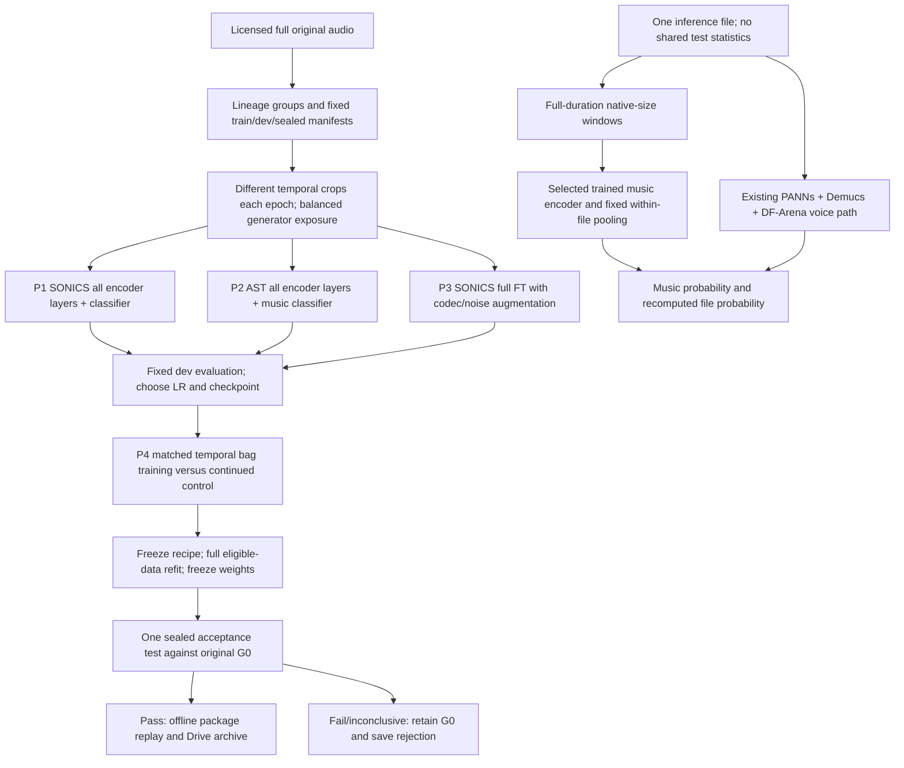

# trainable-recovery-v4 - Work Plan

## TL;DR (For humans)
<!-- Fill this LAST, after the detailed plan below is written, so it summarizes the REAL plan. -->
<!-- Plain English for a non-engineer: NO file paths, NO todo numbers, NO wave/agent/tool names. -->

**What you'll get:** Five pipeline comparisons, including two fully fine-tuned pretrained encoders, a controlled augmentation experiment and a temporal multi-window treatment. Execution delivers a reproducible notebook, trial records, a final eligible-data refit and a submission candidate only if independent acceptance checks pass.

**Why this approach:** Previous AST training updated only its last block, while SONICS was frozen. This plan trains representations on more generators and samples new times from full originals, with independent artist/provider evaluation to catch the earlier development-to-leaderboard regression.

**What it will NOT do:** It will not turn an in-domain proxy into a leaderboard claim, consume more than two hours of A100 time, or submit a rejected/unfinished model.

**Effort:** Large: CPU acquisition/implementation plus at most two hours of A100 allocation.
**Risk:** High: limited independent artists and unknown generator shift; improvement is unproven.
**Decisions to sanity-check:** Full fine-tuning applies to the music detector; working speech/presence paths remain. Thirty epochs is an upper limit, not a completion guarantee. New development and sealed panels each require ten independent artists.

Status: design completed; implementation and new training have not run. Execution follows the tasks below within the existing authorization and resource ceiling.

---

> TL;DR (machine): Large / high risk / 5 pipelines / 6 implementation tasks / 4 final verifiers / 7200-second A100 ceiling.

## Scope
### Must have

Design date: 2026-09-13. This document specifies the next experiment; its models have **not** been trained. User requested substantive pipeline design after failed frozen/partial-fine-tuning attempts. Execution uses the existing maximum **7,200 seconds of A100 allocation**, including setup, evaluation, export and release. CPU data preparation happens before GPU allocation. No additional paid service is needed.

Evidence determining the design:

| Observed fact | Consequence for the next experiment |
| --- | --- |
| Official baseline 0.6909110688; AST633 0.6453405503; AST1029 0.6174819841 | Retain the original baseline as a measured control; an attractive development result cannot override failed acceptance gates. |
| `ast_multitask.py:85` enables block 11, final norm and heads only; audited trainable count 7,093,253 | Implement actual full encoder fine-tuning, and prove gradients and weight changes in early, middle and late blocks. |
| Epoch extension best at 17, stopped at 22 of 30; dev gain 0.0380809099 versus reused274 gain 0.0013888889 | More identical epochs alone have weak support. Extend training only with a new data/optimization contract and new validation. |
| 740 original sources still exist; 1,029 prepared files contain only 4–10 seconds | Recover full originals and sample different timestamps. Full corpus, full duration and full parameter training are three separate claims. |
| Frozen SONICS reduced NSynth false positives but Echoes fake music mean fell from about 0.7403 to 0.2361 | Adapt representations to new generators; do not infer that a threshold change or longer window alone fixes this. |
| Fresh V3 G0 voice EER 0 on 40 known speech labels, music EER 0.3333 on 48 music labels | Prioritize the music branch. Speech result is small-sample evidence, not proof speech is solved. |

Local evidence: `results/submission_audit_20260913/audit.json`, `results/epoch_extension_20260913_013624/measurement_audit.json`, `results/full_refit_20260913/final_weight_audit.json`, `results/recovery_v3/new_candidate_diagnostics.json`, `results/recovery_v3/colab_20260913_044621/rescored_roles.json`.

Research decisions and limits:

- [Echoes v2](https://arxiv.org/html/2603.23667v2) reports poor transfer from existing datasets and difficult held-out-generator detection. Its 4,468 generated tracks and 12 providers match the local pinned manifest. Expand generator coverage and reserve providers, rather than use a random clip split. The v1 paper had different counts/license; use the pinned dataset's terms and v2 for this design.
- [SONICS](https://arxiv.org/abs/2408.14080) studies long-form synthetic songs; the [available gamma-5s checkpoint](https://huggingface.co/awsaf49/sonics-spectttra-gamma-5s) is a specific 5-second model. Keep its native input and aggregate a bag of windows. Changing it to a 120-second alpha model is not a compatible checkpoint edit.
- [Official AST guidance](https://github.com/YuanGongND/ast#use-pretrained-model-for-downstream-tasks) calls for small learning rates and task-specific schedules. Test low-LR full FT as a separate representation control; prior last-block failure does not establish that full FT will succeed or fail.
- [wav2vec2 plus augmentation](https://arxiv.org/abs/2202.12233) supports testing end-to-end adaptation and augmentation in speech anti-spoofing. Transfer of this result to music is a hypothesis, which P3 tests. Codec augmentation may also destroy useful artifacts, so it must beat its matched clean control.
- [Music detector robustness analysis](https://arxiv.org/abs/2405.04181) motivates checking manipulation and unseen-generator performance separately from in-domain accuracy.

### Model and inference graph

Five primary pipeline rows are **G0, P1, P2, P3, P4**. LR probes and matched continuations are subtrials, not five independent discoveries.

| Pipeline | Learned parameters | Controlled comparison | File-level music pooling |
| --- | --- | --- | --- |
| G0 | None; original baseline | Official reference, recomputed on new panels | Original DF-Arena behavior |
| P1 | Entire pinned SONICS gamma encoder and existing binary classifier, 17,172,493 parameters | Whether actual domain full FT improves its epoch-zero frozen predictions | Mean of sigmoid(window logits) |
| P2 | Entire existing pretrained AST backbone and one new music head; enumerate exact count at runtime | Different representation, full FT instead of block 11 | Same mean, using native 10-second windows |
| P3 | Same parameters and initialization as P1 | P1 versus P3 changes only augmentation; same data, LR, steps, seed and pooling at matched checkpoints | Same mean |
| P4 | Best completed, numerically valid P1/P2/P3 encoder, all layers remain trainable | Temporal bag objective plus normalized log-sum-exp versus equal-budget continuation of the same parent checkpoint | Sigmoid of normalized log-sum-exp logits |

P1–P4 keep `VOICE_FAKE_PROB`, `VOICE_PRESENT_PROB`, `MUSIC_PRESENT_PROB` exactly G0. Set `FILE_FAKE_PROB=max(voice_present*voice_fake, music_present*new_music_fake)`. No 50:50 old/new probability blending. Run the new music encoder on raw audio for every file; no hard presence threshold can skip an input. Existing Demucs remains needed for the baseline speech path. If P2 wins, SONICS is absent from the final package. This is full fine-tuning of the **music detector**, not of the entire multi-model submission.

Do not add a 1B full-FT job, a new BEATs integration, an audio LLM, learned routing or a multi-model ensemble in this two-hour comparison. They are distinct future alternatives with new compatibility/data/compute costs. Nothing in current evidence establishes that a larger model or a text reasoning trace improves this task.

### Data contract

1. Reuse original files and metadata in `_workspace/v2_sources/source_inventory.json`, `prepare_v2_sources.py`, `_workspace/v2_discovery/echoes_fma_unique.json` and `archive_probes/echoes_manifest.csv`. Pin Echoes revision `14b0c76c6a691c42fadfab9fb6a4eb1ee8c628a2`. Resolve all author/license notices, including each FMA track's own terms; no license inference from a paper alone. Record failed downloads and exclusions. The pool contains 220 matched tracks but only 106 unique artists. Prior sources/V3 already used 72 of those artists, leaving 34 candidate artists before provider availability, licensing and decoding checks. These are not verified available downloads.
2. Reserve **Stable Audio for OOD development** and **Mubert for sealed OOD acceptance**, excluded from every search-training row and all derivatives. Train providers are `acestep, audioldm, brev, diffrhythm, elevenlabs, musicgen, producer, songgen, suno, udio` using pinned metadata spelling (`producer` is not silently renamed). This is unseen during our adaptation, not a guarantee of absence from model pretraining.
3. Before scoring anything, acquire 10 new dev artists and 10 different sealed artists, excluding all groups/content from the old 1,029 and V3 88. Each artist has its real reference, three training-provider fakes chosen by stable round-robin order, and its role's held-out-provider fake: **50 original music files per panel**. Select by availability, hashes and group identity only. After TTA/three-training-provider availability checks, Stable Audio has 19 candidate artists and Mubert 15, with 13 shared and only 21 in the union. Assign exclusive artists first (6 Stable-only, 2 Mubert-only), then stable-hash ordered shared artists to remaining quotas; verify a complete 10+10 assignment before downloads, retry alternative tracks within assigned artists after failures, and recompute the assignment on acquisition-eligible groups if needed. Require all 10 complete artist groups per role; otherwise finish data preparation or report blocked acquisition before renting a GPU. Do not lower the minimum after seeing performance.
4. Training targets 70 artists, including the old 60 FMA artists and new references outside both panels and the V3 12 artists. Retain all eligible training-provider versions for those artists, not just 3 generators. Require at least 60 artists, at least 6 providers, and at least 20 distinct reference groups per included provider; if a provider cannot meet 20, omit it **before training**, record the omission and do not claim a 10-provider experiment. Hard-negative NSynth is capped at 5% training loss mass. Keep old source-only/partial labels; no inference-derived ground truth.
5. Store complete decoded originals as mono 16 kHz float/PCM with original and decoded duration, file SHA, full PCM SHA, content identity, artist/speaker and parent-group IDs. Extend `decode_audio` with an explicit no-truncation option while preserving its existing default for V2 callers. Never pad or recrop the old 10-second WAV and call that recovered full audio. Stream/chunk decoding and feature caching may bound RAM without discarding source time.
6. Each epoch has a coverage pass over every eligible training file. Repetition to balance real/fake and fake providers is recorded separately; log unique IDs, crops, optimizer steps, samples and temporal coverage. Use inverse-frequency loss weights calculated on the fixed epoch schedule; normalized class mass real/fake=0.5/0.5 and equal total fake-provider mass. NSynth's capped contribution is part of the real half. Thus balancing never silently skips rare training files.
7. All crops/codec variants/mixtures inherit the union of parent groups. Use full-audio fingerprints plus reference identity, not byte hash alone. With uncertain duplicate lineage, quarantine before manifest lock. Old1029 and V3 88 are **reused diagnostics**, never fresh gates; rows included in training cannot provide validation evidence.
8. Match primary evaluation files to the [official 4–60 second input range](https://dacon.io/competitions/official/236749/overview/description). Keep complete original sources, but construct one fixed evaluation excerpt per original: artist order cycles requested durations 4/10/30/60 seconds, and all five versions of an artist use the same effective duration, bounded by their shortest decoded version. Start at a deterministic hash-selected legal timestamp; record offsets and original/evaluation durations before scoring. Consequently the 50-file panel represents 50 source recordings through declared excerpts, not 50 complete songs. Inference covers every sample of each evaluation file. Keep a prespecified 8-source full-song stress panel outside selection, run only if mandatory work fits; absence of that stress test is reported. Training still samples across complete originals.
9. Add role-disjoint controlled panels: 20 new speech pairs for dev and 20 for sealed, disjoint from old and training speech identities. Per role construct 20 sets of music+speech mixtures, each with the four real/real, real/fake, fake/real, fake/fake combinations (80 files), from that role only. Mixtures are 10 seconds or the shortest parent length, with recorded stems and SNRs (-5, 0, +5 dB cyclic). Add 20 matched real/real-splice versus real/fake-splice pairs (40 files), each 30 seconds where sources permit, using equal edits/crossfades. These derivatives are robustness diagnostics, grouped by parents; they are not extra independent observations. Added real speech plus a generated song does not establish VOICE_FAKE=0 because the song may contain synthetic vocals: leave that target unknown. Fake speech establishes VOICE_FAKE=1; all-real parents establish authenticity zero. Presence is asserted only from a known retained constituent. Budget all 210 files per role (50 music +40 speech +80 mixture +40 splice) explicitly.

### Optimization and temporal evidence contract

Shared optimizer: AdamW betas=(0.9,0.999), epsilon=1e-8, weight decay=0.01 on matrix/kernel weights; zero decay on bias/norm parameters. Gradient norm clip=1.0. BF16 autocast on A100 with FP32 STFT, normalization, BCE and optimizer master weights. No new optimizer dependency. Effective batch=32 windows for P1–P3; microbatch starts at 8, falls to 4 or 2 with accumulation; OOM never causes implicit layer freezing. Full FT enables every learned encoder parameter; deterministic feature buffers are not trainable parameters.

- P1/P3 encoder peak LR candidates: **1e-5, 3e-5, 1e-4**. Classifier LR=3×encoder LR. P2 encoder: **1e-6, 3e-6, 1e-5**; new music head LR=1e-4. Lowest-to-highest LR tie order. These are proposed search values, not published optimums.
- Each independent trial reloads pinned original weights and a reproducible head initialization. SONICS retains its pretrained classifier; AST replaces the task head. Do not warm-start from the rejected AST1029 checkpoint.
- Each LR probe uses the same training subset, crop sequence and initial seed `20260913`, up to 60 optimizer updates. A completed probe is only a stability/shortlisting measurement. Do not compare a 20-update interrupted trial with a completed 60-update trial as an architecture win. Top LR per encoder moves to the main run, ranked by held-out dev objective with finite gradients required.
- P1/P2 main run budget is **30 epochs maximum**, validation after each complete epoch, patience=5 epochs after at least 5 completed epochs; improvement threshold 0.002 on the dev selection objective. Warm up linearly for the first full epoch from 0.1×peak LR, then cosine decay to 0.1×peak over the fixed planned 30-epoch horizon. A resumed run preserves optimizer, scheduler position, RNG and exposure ledger. P3 runs for exactly P1's completed update count and scheduler positions with independent patience disabled; compare its checkpoints to P1 at the same epochs and choose from those completed checkpoints. P3 inherits P1's chosen LR and crop sequence. Reserve the matched P3 cost before allowing P1 to extend. Save best and latest separately. Do not reset a short cosine schedule every time a trial gets more time.
- P1/P2 training draws one native-length crop/file/epoch from the full original: divide legal start positions into 8 temporal strata; cycle the stratum by stable file hash plus epoch and randomize within it. Short sources use zero padding with recorded original length. This makes coverage deliberate, but does not claim every second was used in every epoch. Evaluation covers each declared evaluation file completely; it never center-crops an incoming inference file. Primary excerpt construction is a separate, documented dataset operation above.
- P1/P2 common augmentation is only random gain in [-6,+6] dB with identical label-independent application. For P3 add: identity 50%; MP3 or AAC encode/decode 30% total, 64/128/192 kbps equally; mild resample 16→12→16 kHz 10%; additive noise 20–35 dB SNR 10%. Choices are disjoint, same distribution for both classes/providers. Prepare codec caches on CPU before GPU allocation and retain exact duration/delay alignment. No automatic pitch/time stretch, source-separation training or strong frequency masking in this round.
- SONICS's supplied training config enables MixUp and spectrogram masking. **Disable both for P1–P4 unless explicitly assigned above**; otherwise P1 is not the claimed control. Preserve its pretrained feature contract. Batch dB conversion must be per-example (e.g. `[B,1,F,T]` before `AmplitudeToDB`, then remove channel), verified against serial processing. Do not train through `SonicsPredictor.predict`, which is inference-only with `no_grad` and float conversion.
- P1–P3 loss is weighted binary BCE on **known music-present/music-authenticity labels**. Missing voice/music truth is never converted to zero. Maintain no unused five-head loss merely because AST originally had five heads.

Evaluation window starts are fixed: SONICS uses `SonicsPredictor._window_starts` with a final full window anchored at the tail; AST uses `ast_multitask.split_audio` with its nonoverlapping partial tail handled by the pinned processor. P4 inference uses its parent's exact grid. No duplicate last window is appended. Short training files use K<=4 distinct windows, mask absent bag entries, and do not duplicate a single window to invent temporal evidence.

P4 receives up to four windows from the parent model's native size, sampled from four strata across the original (20 seconds of observed audio for SONICS, 40 for AST, spread over the file). This is multi-instance learning across the file, **not full-song cross-window attention**. Fixed pooling is `s=logsumexp(2*z)/2-log(K)/2`, `p=sigmoid(s)`, evaluated over all windows at inference. Duplicating every window leaves this normalized pooling unchanged; adding genuine content can still dilute a rare fake, so long-tail checks are required. Noisy-OR is excluded because its score can inflate solely with file length.

Use `L = bag_BCE(s, bag_label) + 0.5 * mean_known_window_BCE(z, window_label)`. Natural-source bags use justified file-level music labels only; do not broadcast a file label into unobserved segment truth. Auxiliary window labels exist only for provenance-verified homogeneous construction parents and generated partial-edit examples with stored masks. If no window label is known, auxiliary loss is zero; bag loss keeps weight 1. For synthetic temporal partial fakes, track exact boundaries. In 25% of P4 training bags, replace 5–20 seconds of a real music parent with fake music from the **same split**; include both positive and genuine windows by construction and create an equal number of identically processed real/real edits. Exclude boundary-straddling windows from auxiliary loss; bag targets depend on whether a retained window actually contains fake audio. Unknown/homogeneity-uncertain labels contribute only where justified. No soft MixUp target may turn “contains fake audio” into “fraction fake”. Effective batch=8 bags×4 windows, with gradient accumulation if needed. All encoder layers remain connected to both losses.

P4 and the continued parent start from identical selected parent weights and receive equal additional optimizer updates and window exposures. Parent selection can use a numerically valid completed model that has not yet passed deployment gates, allowing P4 to test whether the temporal treatment repairs it. Parent continuation keeps its original objective and mean pooling. Log P4's combined objective/partial-edit change as a combined treatment; do not attribute an observed gain to pooling alone. On saved dev window logits, evaluate mean versus fixed log-sum-exp as a prespecified diagnostic, not an extra post-lock hyperparameter search.

### Ranking, final refit and acceptance

Use the exact DACON `roc_curve(..., pos_label=1, drop_intermediate=False)` nearest-crossing EER implementation, already in `graph_scoring.py`. A single monotonic sigmoid-temperature change does not change within-head ranks/EER/AUC, so do not spend the budget on threshold-only tuning as a detection improvement.

All candidates share identical panel IDs. Define unrenormalized known-head gain `D=.45*(G0_file_EER-candidate_file_EER)+.27*(G0_music_EER-candidate_music_EER)`. The unchanged speech/presence terms cancel in a paired comparison; absolute five-head score stays null where labels are missing. The official hidden distribution remains unknown.

For each main checkpoint calculate D separately on the **seen-provider panel** (real+3 training-provider versions per artist) and **OOD-dev panel** (real+Stable Audio per artist). Rank by `min(D_seen,D_ood)`, then larger music AUC, then lower measured runtime, then fixed pipeline order. Save all checkpoint curves, not only winners. It is valid to select G0.

Development eligibility: both D values >=0.005; neither panel's file/music EER worsens by >0.01; music AUC does not fall by >0.01. Cluster-bootstrap artist/connected parent groups 2,000 times with paired G0/candidate predictions; require P(D>0)>=0.80 and p10>=0 for both panels, counting invalid single-class draws and requiring >=90% valid draws. This is an engineering gate on a small panel, not a multiple-testing-adjusted proof. Controlled speech/mixture panels must show unchanged protected outputs and file EER regression <=0.02. Old reused diagnostic results cannot rescue a rejected candidate.

Before final ranking, resource eligibility requires `1.25 * projected_complete_refit_seconds <= reserved_refit_seconds_remaining`; for P4 include both parent and temporal stages. Resource-ineligible candidates remain reported and cannot be locked. After choosing one eligible recipe, write immutable `recipe_lock.json` with selected parent/P4 treatment, LR, scheduler, epoch count, data and source hashes, pooling, seeds and gate thresholds. **Before opening sealed predictions**, refit from the pinned original pretrained weights on all eligible training plus dev public groups, with the locked recipe and fixed completed epoch count (for P4 repeat the locked parent stage plus locked P4 stage). Retain sealed artists/speakers and Mubert outside the refit. Dev Stable Audio becomes explicitly seen in refit. Save exact per-file exposures and per-layer updates. This is full eligible-data training with an untouched acceptance set; it is not training on every downloaded public file. Speech-only files are not music-supervision examples.

Write `weight_lock.json` binding the final refit weights and inference code, then evaluate **only that candidate versus G0** on the sealed seen/Mubert panels and sealed controlled derivatives. Apply the same gates. No runner-up promotion or tuning after opening them. If refit cannot complete within budget, keep the selected search checkpoint as an experimental artifact, mark `refit_incomplete`, and **do not submit it as a full-data model**. If sealed fails, retain G0. If it passes, package precisely those evaluated weights; do not perform another untested refit afterward.

### GPU budget and notebook cells

| Stage | Hard allocation in minutes | Decision at boundary |
| --- | ---: | --- |
| Dependencies, pinned loads, all-layer gradient/parity checks and throughput profile | 8 | Fail before expensive search if integration is broken |
| G0 cache for new dev panels and controlled examples | 12 | Incomplete dev panel means no candidate ranking |
| Six LR probes, including dev scoring | 15 | Complete equal-update probes or label them resource-censored |
| P1/P2/P3 main fits and checkpoint evaluation | 25 | Compare only complete common-rung evidence; P1/P3 use matched updates |
| Best-parent continuation and P4 treatment | 20 | Continue from identical parent, equal exposure; no forced P4 win |
| Locked eligible-data refit | 15 | Complete every prescribed epoch or mark incomplete |
| Sealed G0/candidate and control-panel evaluation | 10 | Missing IDs/metrics cannot pass |
| Offline replay, export, Drive verification and release | 5 | Export only weights matching the sealed result |
| Reserved failure/checkpoint-save allowance | 10 | Total 120; watchdog saves/releases before 7,200 s |

These are **ceilings, not measured completion estimates**. Task 3 profiles train updates and full-file G0/new inference, including p95 duration and peak memory. Before search, project the cost of all mandatory evaluation and full-refit work with a 1.25 safety factor. If it exceeds the reserve, reduce search updates, not validation IDs, audio duration, layer coverage or refit completeness. At least 5 completed main epochs are required for a promotion; otherwise record insufficient budget. Precheck whether final refit's selected number of epochs fits its reserve before admitting an extended checkpoint. Do not claim a 30-epoch comparison when wall time stopped at 4 epochs.

Use one A100 at a time, cache only deterministic nontrainable inputs and G0 predictions keyed by file/PCM/preprocessing/code/model hashes, and unload G0 during training. No cached encoder embeddings while claiming encoder fine-tuning. Profile adjusted microbatch before using checkpointing; enable checkpointing only if supported and its additional time fits. Atomic local writes mirrored to Drive, checkpoint every epoch and every 60 seconds during long epochs. Stop new work by 6,900 seconds; watchdog requests save and runtime release by 7,080 seconds. UI units are recorded before/after; “120 minutes” is not a promised unit cost.

Notebook cell order: Drive mount/input hashes → CPU-prepared archive validation → environment/profile → G0 dev cache → LR probes → main matched fits → P4/continuation → recipe lock → refit → weight lock → sealed acceptance → offline package replay → Drive receipts → GPU release. No implicit run-all cell may submit to DACON. Existing submission authorization permits a separately verified submission after the concrete package/result is reported; never upload a rejected model.

### Must NOT have (guardrails, anti-slop, scope boundaries)

- No private test training, pseudo-labeling, test-time weight/statistic updates or cross-file score normalization. Within-file segmentation is permitted by [DACON rules](https://dacon.io/competitions/official/236749/overview/rules).
- No fabricated fresh holdout from relabeling old1029 or V3 88, no unknown-label coercion, no hidden-test score claims based on local proxies.
- No silent checkpoint substitution, automatic ensemble sweep, strong augmentation default inherited from upstream, or continued GPU rental after failure.
- [Submission constraints](https://dacon.io/competitions/official/236749/overview/evaluation): offline inference, L4 22.4 GiB, 60-minute inference and 10-minute installation limits, zip <=10 GB/extracted <=32 GB. Match the original script's verified input contract; the web page mentions both `data/` and `open/`, so do not rewrite its paths from the ambiguous prose alone.

## Verification strategy
> Zero human intervention - all verification is agent-executed.
- Test decision: meaningful tests alongside implementation using existing pytest; real data/gradient/replay measurements decide completion. No new test framework.
- Execution evidence root: `results/trainable_recovery_v4/<run_id>/`; `.omo/drafts/trainable-recovery-v4.md` records design review. Tests protect actual failure modes: source leakage, full-FT connectivity, batching dependence, false partial-audio labels, failed-candidate promotion and packaged inference mismatch.

## Execution strategy
### Parallel execution waves
> Target 5-8 todos per wave. Fewer than 3 (except the final) means you under-split.

Wave 1 (CPU/preparation): tasks 1–3; acquisition and model adaptation can run independently after role contracts are fixed. Wave 2 (experiment/integration): tasks 4–6, one GPU serially. Final verification runs after artifacts exist. No GPU is started during this design turn.

### Dependency matrix
| Todo | Depends on | Blocks | Can parallelize with |
| --- | --- | --- | --- |
| 1 | None | 2,3,4 | Initial source reads for 2/3 |
| 2 | 1 | 4 | 3 |
| 3 | 1 | 4 | 2 |
| 4 | 2,3 | 5 | None on GPU |
| 5 | 4 | 6 | CPU report preparation |
| 6 | 5 | F1–F4 | Independent final checks |

## Todos
> Implementation + Test = ONE todo. Never separate.
<!-- APPEND TASK BATCHES BELOW THIS LINE WITH edit/apply_patch - never rewrite the headers above. -->
- [ ] 1. Pin data roles, model identities and licensing before acquisition
  What to do: write `v4_validation/protocol.json` and source receipts with exact provider/artist selection order, quotas, exclusion hashes and intended inference contract. Read all applicable AGENTS/skills. Preserve unrelated worktree edits. Reuse `prepare_v2_sources.py` constants and existing pinned assets; confirm AST model/revision from `_workspace/v2_discovery/ast_assets_receipt.json`, SONICS revision `a349d427b681fa15e3d0e22d1708108322f967b1` and source commit `9156ffad151f797c71556923c4a02fa01fa8fc91`.
  Parallelization: Wave 1 | Blocked by none | Blocks 2–4.
  References: `prepare_v2_sources.py:23`, `prepare_recovery_data.py:100`, `recovery_sonics.py:21`, `_workspace/v2_discovery/echoes_fma_unique.json`, `recovery_validation/provenance.json`.
  Acceptance: every resource has a pinned source and permitted-use notice; old and new group exclusions are explicit; no model predictions used in selection.
  QA: Python manifest audit accepts licensed disjoint entries; injected old artist, derivative parent or held-out training provider is rejected. Evidence `data_protocol_audit.json`.
  Commit: Y | Record trainable recovery data and model protocol.

- [ ] 2. Recover full originals and build train/dev/sealed data with valid labels
  What to do: add `prepare_v4_data.py` using existing fetch/archive/hash/group helpers, and narrowly extend `v2_data.decode_audio` with explicit full decoding. Produce manifests, provenance, aligned augment caches and original-duration ledger under `v4_validation/`; ignored audio and split archives go to Drive project root. Construct controlled mixtures/splices with ancestry and boundary annotations. Do not overwrite V2/V3 banks.
  Parallelization: Wave 1 | Blocked by 1 | Blocks 4 | May run alongside 3.
  References: `v2_data.py:66`, `prepare_v2_sources.py:98`, `prepare_recovery_data.py:85`, `v2_scoring.py:181`, data contract above.
  Acceptance: acquire required 10+10 new artist groups; all training original paths/durations/hashes audited; no role overlap; every controlled label traceable to its parents; all newly selected providers satisfy fixed quotas.
  QA: `pytest -q test_v4_data.py` validates source/parent leakage rejection and later-than-10-second crop content using a real long source; boundary cases verify real/real edit remains real and unknown labels remain masked. Evidence `data_integrity.json`, `label_audit.json`, `duration_audit.csv`. File existence/shape alone does not pass.
  Commit: Y | Prepare complete-source audio and disjoint recovery panels.

- [ ] 3. Implement full-FT encoders and verify gradient, feature and pooling contracts
  What to do: add minimal `v4_model.py` adapters using installed torch/transformers and pinned SONICS vendor. Reuse AST processor/offline loader; keep old V2 mode behavior. Define explicit one-logit music objective and P4 bag loss, safe per-example dB and disabled upstream augmentation. Verify all learned encoder tensors belong to optimizer; save counts and per-block gradient/update measurements.
  Parallelization: Wave 1 | Blocked by 1 | Blocks 4 | May run alongside 2.
  References: `ast_multitask.py:61`, `ast_multitask.py:85`, `recovery_sonics.py:53`, `_workspace/recovery_v3/sonics_vendor/sonics/models/model.py:98`, `sonics/layers/feature.py`, `sonics/layers/augment.py` in that vendor root.
  Acceptance: early/middle/late blocks and classifier have finite nonzero accumulated gradients and measurable updates on real labeled batches; unused trainable parameters investigated; no `no_grad`/detach break. FP32 batched/serial inference parity <=1e-5 on quiet/loud and unrelated mixed batches. Normalized pooling invariant to duplicating the whole bag within 1e-6; a late fake changes measured predictions versus the paired all-real file, with quality quantified separately.
  QA: `pytest -q test_v4_model.py`; runnable real A100 gradient/profile cell saves `gradient_audit.json`, `feature_parity.json`, `throughput_profile.json`. Deliberately detached encoder or batch-wide top_db implementation must fail the meaningful check. Do not count pure shape checks as evidence.
  Commit: Y | Add full encoder training and temporal music objectives.

- [ ] 4. Build and run the bounded notebook search with matched controls
  What to do: add `train_v4.py` and `build_v4_notebook.py`, reusing Drive/archive/bootstrap/logging patterns from V3, not a new experiment framework. Generate `DACON_236749_trainable_v4.ipynb`. Implement checkpoint/resume, LR shortlist, full-source crop ledger, matched P1/P3 and P4/parent budgets, and explicit resource-censoring. Upload ready data/notebook before A100 allocation; operate the user's Aside Colab under the existing authorization.
  Parallelization: Wave 2 | Blocked by 2,3 | Blocks 5.
  References: `train_v2.py:164`, `train_v2.py:248`, `build_recovery_notebook.py:33`, `run_recovery.py`, GPU table and optimization contract above. Do not reuse V2's hard-coded `epoch=0` crop path as the new epoch sampler.
  Acceptance: six probe outcomes and five primary pipeline rows each have measured result or explicit not-run/censored reason; epochs/steps/unique files/seconds/VRAM are actual values. No dev/sealed data in optimization; sealed inference has not run. Each completed epoch covers its declared eligible corpus.
  QA: resume a real saved checkpoint for one deterministic next update and compare uninterrupted CPU/FP32 trajectory within 1e-6 (A100 BF16 tolerance documented separately); force a short wall-time boundary and confirm save/stop without a success claim. `pytest -q test_v4_training.py`. Evidence `trials.jsonl`, `epoch_metrics.csv`, `exposures.json`, executed notebook and `budget_events.jsonl`.
  Commit: Y | Run bounded full-fine-tuning comparison and preserve outcomes.

- [ ] 5. Lock, fully refit and accept or reject exactly one model
  What to do: implement V4 gate logic in the runner using existing ROC and connected-group bootstrap helpers. Freeze recipe, estimate remaining refit cost, complete prescribed training on all eligible train+dev public groups, freeze weights, then run sealed comparison. If no dev candidate qualifies or refit is incomplete, retain G0 and do not open sealed predictions unnecessarily.
  Parallelization: Wave 2 | Blocked by 4 | Blocks 6.
  References: `graph_scoring.py:113`, `v2_scoring.py:181`, `recovery_selection.py:133`, `results/recovery_v3/colab_20260913_044621/selection.json`, ranking/refit contract above.
  Acceptance: `selection.json` recomputes from saved CSVs; candidate recipe/weights precede sealed open time; all prescribed refit epochs and file exposures complete; either every gate passes or status is rejected/inconclusive with G0 retained. Data used for refit is never described as held out.
  QA: `pytest -q test_v4_selection.py` includes attractive dev mean but negative OOD result, missing predictions, changed weight hash, and incomplete refit; every such case refuses promotion. Evidence `recipe_lock.json`, `refit_manifest.csv`, `final_weight_audit.json`, `weight_lock.json`, `sealed_opened.json`, `selection.json`.
  Commit: Y | Record locked refit and sealed acceptance decision.

- [ ] 6. Replay the accepted package, save results to Drive and release A100
  What to do: only on acceptance, extend existing package builder patterns to embed trained music weights and selected adapter while preserving original script entrypoint. Replay the actual ZIP in an offline extracted directory under Python3.11.15/torch2.7.1-compatible environment. Save all runs even on rejection; upload exact notebook, config, CSVs, checkpoint hashes and readable comparison report to `MyDrive/DACON_236749/runs_trainable_v4/<run_id>/`. Release GPU and verify Aside shows no active runtime.
  Parallelization: Wave 2 | Blocked by 5 | Blocks F1–F4.
  References: `package_v2_submission.py:60`, `baseline_original/script.py`, `verify_recovery_results.py`, `results/recovery_v3/colab_20260913_044621/drive_receipt.json`, official submission constraints above.
  Acceptance: packaged probabilities match selected reference within 1e-5, IDs/order are exact, full-tail coverage and inference per-file independence pass; restored code/weight hashes match sealed artifact. GPU allocation <=7200s; Drive objects retrieved and hash/semantic-checked. If only A100 was measured, clearly mark L4 runtime unverified and projections as estimates.
  QA: actual ZIP inference on real short/long/mixture/silence samples, reverse file order and batch composition, network disabled; inspect produced probabilities and match reference. No silent default probabilities for decode failure. Save `package_replay.json`, `coverage_timing.json`, `drive_receipt.json`, `released.png`, `report.md`. No automatic DACON submission from notebook.
  Commit: Y | Archive reproducible training results and verified submission candidate.

## Final verification wave
> After execution artifacts exist, review them independently. No new permission pause is needed to verify work already authorized. Plan completion and experiment completion are separate statuses.
- [ ] F1. Plan compliance audit
  Verify actual trainable layers, prescribed file exposures, role exclusions, gate chronology and 7200-second budget from raw artifacts; reject a self-reported full-FT claim without updates.
- [ ] F2. Code quality review
  Audit data loader, optimizer/scheduler resume, pretrained preprocessing and inference wiring; no unrelated changes or new dependencies without need.
- [ ] F3. Real manual QA
  Check executed Colab outputs, retrieved Drive artifacts, GPU release and actual offline ZIP replay. A generated notebook alone is not an executed experiment.
- [ ] F4. Scope fidelity
  Report measured improvement, rejection or incomplete budget honestly. Full eligible-data/full parameter/full duration claims each match their own ledger. No failed candidate submitted.

## Commit strategy

Commit this design locally after source/review reconciliation. During execution commit one behavior plus its relevant checks/evidence at a time, retaining ignored large audio/model files in Drive. Never push or rewrite history without a request. Preserve unrelated edits.

## Success criteria

Design completion: fixed comparison matrix, trainable parameter scope, data protocol, loss/schedule/epoch definitions, resource and rejection rules, sources and six executable tasks are concrete and reviewable. This document does not establish a score improvement.

Execution completion: every attempted trial has a reproducible outcome, artifacts are saved/retrievable and GPU is released. Improvement success additionally requires the final refit weights to pass the sealed gates and offline replay. If no candidate qualifies, record a failed improvement attempt and retain G0; do not conflate safe execution with model quality.
