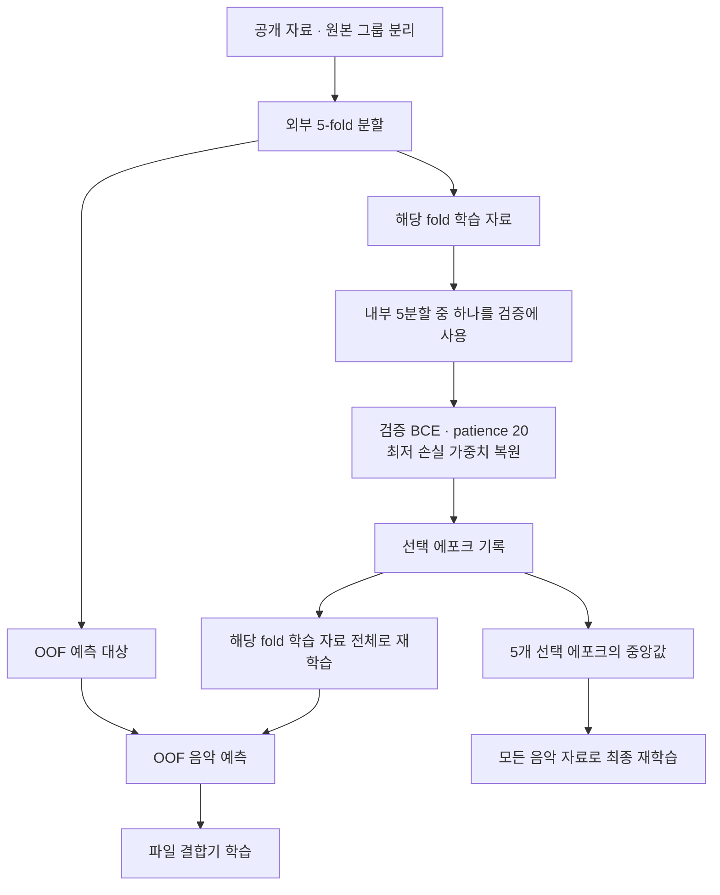
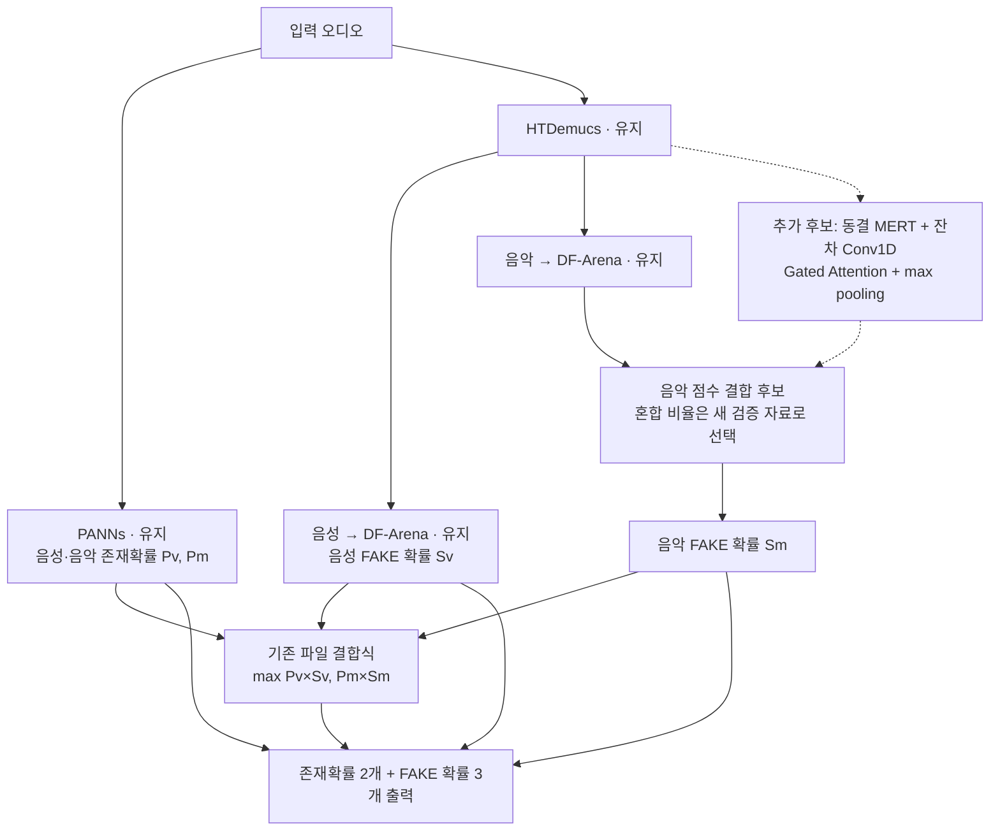
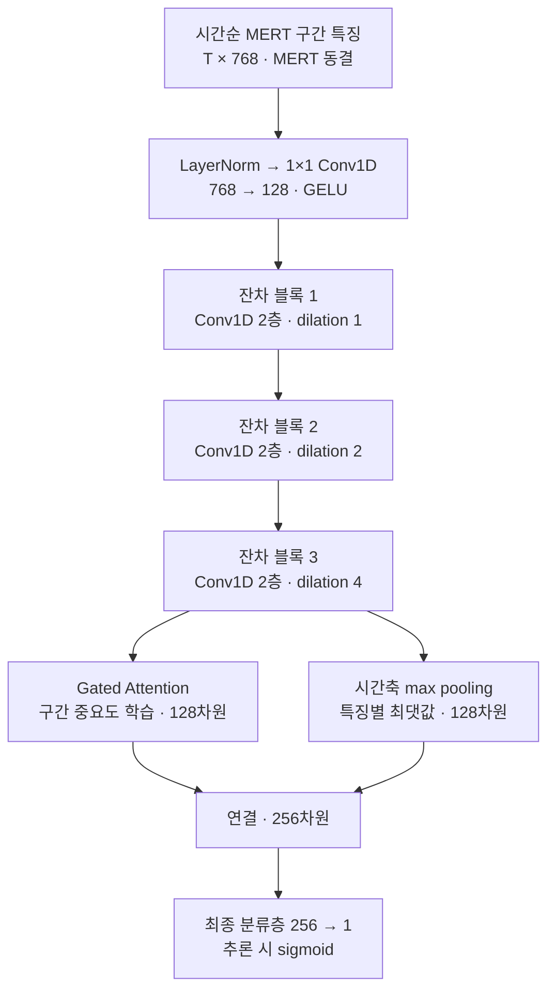

# Early stopping과 베이스라인 개선 후보

현재 상태: 로컬 음악 분류층 학습 코드와 최종 학습 노트북에 Early stopping을 반영했다. 추가로 `music_temporal.py`에 잔차 Conv1D 심층 후보와 독립 학습·예측·체크포인트 저장 함수를 구현했다. 새 후보는 C3 최종 OOF 노트북이나 제출 런타임에 아직 통합하지 않았다. 새 GPU 학습은 실행하지 않았다. 이미 제출한 C3 ZIP과 결과 기록은 이전 300에포크 모델 그대로다.

## 구현한 학습 제어

| 설정 | 값 |
|---|---|
| 최대 에포크 | 300 |
| 검증 주기 | 매 에포크 |
| 중단 기준 | 검증 손실의 유의미한 개선이 20회 연속 없을 때 |
| 최소 개선폭 | 0.0001 |
| 검증 손실 | 파일별 음악 확률을 max로 집계한 클래스 균형 BCE |
| 복원할 가중치 | 관측된 검증 손실이 가장 낮았던 에포크 |
| 최종 전체 학습 | 5개 내부 검증에서 선택한 에포크의 중앙값만큼 새로 학습 |

최소 개선폭은 patience 초기화에 적용한다. 더 작은 개선이라도 최저 손실이면 가중치를 저장한다. 정규화 통계는 해당 학습 자료에서만 계산한다. 검증에서는 무작위 구간 하나를 고르지 않고 추론과 같은 전체 구간의 max 확률을 사용한다. 학습용 저정보량 구간 필터를 검증에 추가로 적용하지 않는다.

OOF 예측 대상의 정답은 에포크 선택에 사용하지 않는다. 외부 fold와 내부 분할 모두 전체 자료에서 계산한 원본 연결 그룹을 따른다. 최종 전체 학습에는 별도 검증 자료가 없으므로 Early stopping을 직접 적용하지 않고 선택한 학습 길이를 사용한다. 검증 손실과 OOF 예측은 학습·선택 용도이며 독립 성능 점수가 아니다. 새 자료로 개선 여부를 평가해야 한다.

## 앞으로 비교할 추론 구조

MERT 예측이 DF-Arena의 오류를 보완하는지 먼저 확인한다. 결합 비율과 추가 미세조정 여부는 아직 정하지 않았다. 구성 요소의 단독 효과를 진단할 때는 해당 출력 하나만 바꾸고 나머지 네 출력은 베이스라인으로 고정한다. 위 구조는 그 진단 이후 비교할 통합 후보다.

## 구현한 심층 음악 후보

| 항목 | 새 후보 설정 |
|---|---|
| 학습 파라미터 | 414,017개; 동결 MERT는 제외 |
| 시간축 합성곱 | 잔차 블록 3개 × Conv1D 2개 = 6층 |
| 입력 투영 | 별도 1×1 Conv1D, 768 → 128 |
| 합성곱 설정 | 채널 128, kernel_size 3, dilation 1·2·4 |
| 잔차 연결 | 각 블록 입력을 두 번째 합성곱 출력에 더함 |
| 정규화 | 입력 및 각 시간축 합성곱 앞에 구간별 LayerNorm |
| 활성화·규제 | GELU, 잔차 블록의 각 합성곱 뒤 Dropout 0.2 |
| Attention | tanh 분기 × sigmoid 게이트, 내부 차원 64, 시간축 softmax |
| 파일 표현 | Attention 가중합 128 + 특징별 max 128 = 256차원 |
| 기본 학습 | AdamW, learning_rate 0.0003, weight_decay 0.01 |
| 배치 | 16개 파일, 파일의 전체 특징 시퀀스를 사용; 매 epoch 모든 파일을 한 번씩 방문 |
| 손실 가중치 | FMA 45%, NSynth 5%, 생성 음악 50%; 생성기별 균등 |
| Gradient clipping | 전체 gradient norm 1.0 |
| Early stopping | 기존 공통 구현 재사용; 최대 300, patience 20, min_delta 0.0001 |
| 검증 지표 | 새 모델의 파일별 MUSIC_FAKE logit에 대한 클래스 균형 BCE |
| 학습률 스케줄러 | 없음; 현재 값은 실험 시작값이며 최적값 미확인 |
| Seed | 41 |

시간축 Conv1D는 구간들의 순서를 사용하며, 인과 마스킹 없이 앞뒤 구간을 함께 본다. 패딩·비가청 구간은 각 합성곱 단계에서 마스킹하고 시간축 슬롯을 유지한다. 전체가 비가청이면 음악 FAKE 확률을 사실상 0으로 처리해 Attention의 NaN을 막는다. LayerNorm은 파일·배치 통계를 공유하지 않는다. 마지막 분류층은 Linear이지만 그 앞의 시간축 특징 처리와 집계는 잔차 합성곱·GELU·게이트를 사용한다.

현재 입력은 기존에 시간 평균한 4.0375초 구간별 특징이다. 6개 합성곱의 이론적 수용영역은 29개 구간 위치이며, 짧은 파일에서는 경계 패딩이 포함된다. 이 구조가 구간 내부의 세밀한 합성 흔적까지 복원하는 것은 아니다. 더 세밀한 시간 해상도를 쓰려면 MERT 프레임 특징을 새로 추출해야 한다.

`fit_temporal_head`는 원본이 겹치지 않는 음악 학습·검증 행과 캐시를 받아 실제 후보를 학습한다. 학습용 캐시에는 기존 품질 마스크를 적용하고 검증용 캐시는 그대로 전달한다. 반환된 모델은 `predict_temporal_music`으로 음악 확률을 계산하고, `temporal_music.pt`는 `load_temporal_head`로 복원한다. 기존 `heads.npz`와 호환되는 파일로 가장하지 않으며 제출 ZIP을 변경하지 않는다. 향후 교차검증·베이스라인 결합·제출 런타임 연결은 별도 작업이다.

구조 참고: [잔차·팽창 시간축 합성곱 연구](https://arxiv.org/abs/1803.01271), [Gated Attention MIL](https://proceedings.mlr.press/v80/ilse18a.html). 이 프로젝트에 적용한 구성의 성능은 아직 측정하지 않았다.

## 확인한 범위

- 학습 손실이 감소하지만 검증 손실이 증가하는 조건에서 조기 중단과 최저 손실 가중치 복원을 확인했다.
- 검증 자료가 학습 정규화 통계·가중치 업데이트에 섞이지 않고, 같은 원본을 공유하면 거부하는지 확인했다.
- 실제 분류층·결합기 학습과 저장된 가중치의 패키징 로더를 연결해, 선택 에포크만큼 전체 재학습하는 경로를 확인했다.
- 실제 1,886개 자료의 분할에서 내부 학습·검증·외부 OOF 대상의 원본 그룹이 겹치지 않고 클래스·출처 가중치 계산이 가능한지 확인했다. 수치는 `results/c3_early_stopping_split_checks_20260915.json`에 기록했다.
- 새 심층 후보의 시간축 합성곱과 Attention 게이트에 gradient가 전달되고, 실제 학습 함수가 학습 손실을 줄이는지 합성 특징으로 확인했다. 이는 오디오 판별 성능 측정이 아니다.
- 패딩·배치 동료에 대한 파일별 예측 독립성, 시간 순서의 영향, 전체 비가청 입력의 유한한 출력, 최적 checkpoint 복원 후 실제 예측 일치를 확인했다.
- 성능 개선, 새 GPU 학습, 수정 모델의 대회 제출은 아직 하지 않았다.
