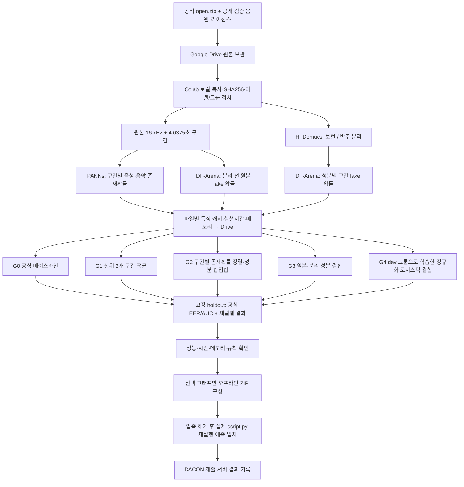

# DACON 236749: 제한된 A100 예산으로 비교하는 5개 파이프라인

이 설계는 3개 사전학습 모델의 연산 결과를 공유하는 **추론·실험 의존 그래프**다. GNN을 추가하는 설계가 아니다. 공식 더미 음원은 정답이 없고 세 파일이 동일하므로 입출력 검증에만 쓴다. 성능 비교에는 별도 공개 음원을 사용하며, 그 결과를 비공개 리더보드 성능으로 간주하지 않는다.

`v_t, m_t`는 구간별 성분 fake 확률, `p_t, q_t`는 구간별 음성·음악 존재확률이다. `r_t`는 분리 전 원본의 fake 확률이다. 모든 집계는 한 파일 안에서만 수행한다.

| 그래프 | 성분 출력과 파일 출력 | 검증할 가설·실패 가능성 |
|---|---|---|
| G0 | V=max(v), M=max(m), P=max(p), Q=max(q), F=max(PV,QM) | 공식 기준점. 분리 왜곡과 한 구간의 오탐에 민감할 수 있다. |
| G1 | V,M을 각각 상위 min(2,K)개 구간 평균으로 변경 | 단발성 오탐을 줄일 수 있지만 짧은 위조 구간을 약화할 수 있다. |
| G2 | V,M,P,Q는 G0. F=max_t[1-(1-p_t v_t)(1-q_t m_t)] | 서로 다른 시간의 존재·위조 증거를 잘못 곱하는 문제를 줄인다. noisy-OR는 독립성 가정이 정확하지 않아 과대평가할 수 있다. |
| G3 | V=.75max(v)+.25max(r), M=.75max(m)+.25max(r), F=max(max(r),PV,QM) | 분리 과정에서 사라진 위조 단서를 보완한다. 원본에서 찾은 위조를 잘못된 성분에 전달할 위험이 있다. |
| G4 | raw/stem 확률 요약·존재확률·불일치·구간 수로 3개 정규화 로지스틱 헤드 학습. 존재 출력은 PANNs 유지 | 연산량 증가 없이 결합을 학습한다. 작은 dev 표본과 데이터 출처의 편향에 과적합할 수 있다. |

G0–G3의 식과 G4의 `C=0.1`은 holdout 평가 전에 고정한다. 단조 스칼라 보정만으로는 EER/AUC의 순위가 바뀌지 않으므로, 이를 별도 개선 모델로 세지 않는다. G4에서 해당 성분의 dev 정답이 부족하면 그 헤드는 G0으로 돌아가고 보고서에 학습 불가를 기록한다.

## 검증과 예산

- 원본·합성 대응본·전화채널 변형·혼합본은 공통 `group_id`로 묶는다. 그룹은 dev와 holdout 양쪽에 나타날 수 없다. 같은 출처의 holdout은 새로운 생성기 전체에 대한 일반화 증거가 아니다.
- 음성에는 노래 보컬도 포함된다. 음악 파일에 보컬이 있는지 확인되지 않으면 음성 정답을 비워 두고 해당 성분 평가에서 제외한다. 음악의 파일 단위 fake 라벨만으로 성분별 fake 라벨을 만들지 않는다.
- 공식 총점은 5개 지표가 모두 계산 가능할 때만 표시한다. 단일 클래스·정답 누락은 평가 불가로 보고한다. 제공 더미에는 성능 점수를 계산하지 않는다.
- A100 연결부터 최대 120분. 실행 코드는 파일 경계에서 시간을 확인하고 중간 결과를 Drive에 저장한다. 종료·패키지 검증 시간을 남겨 특징 추출은 기본 100분 한도로 시작한다.
- 원본 다운로드·Drive 업로드·코드 준비는 GPU 연결 전에 한다. 1B 전체 미세조정과 새 대형 모델 추가는 이번 비교에 포함하지 않는다. 실제 실행시간을 확인한 뒤 표본 수를 조절한다.
- 제출 서버는 L4 22.4 GiB, 1,200개 파일에 60분이다. A100 측정만으로 L4 시간 준수를 주장하지 않는다. 개별 파일과 60초 입력의 시간·메모리를 기록하고 최종 서버 결과를 확인한다.
- 하루 3회 제한이 있으므로 5개 모두를 즉시 제출하지 않는다. 기존 공식 베이스라인 1회를 기준으로 검증을 통과한 후보를 선택한다.

대회 조건·원문 출처는 [COMPETITION_CONTRACT.md](COMPETITION_CONTRACT.md), 외부 음원의 권리와 선정은 [DATA_SOURCES.md](DATA_SOURCES.md)에 기록한다. 이 문서는 실험 전 설계이며 성능 향상 결과를 주장하지 않는다.
