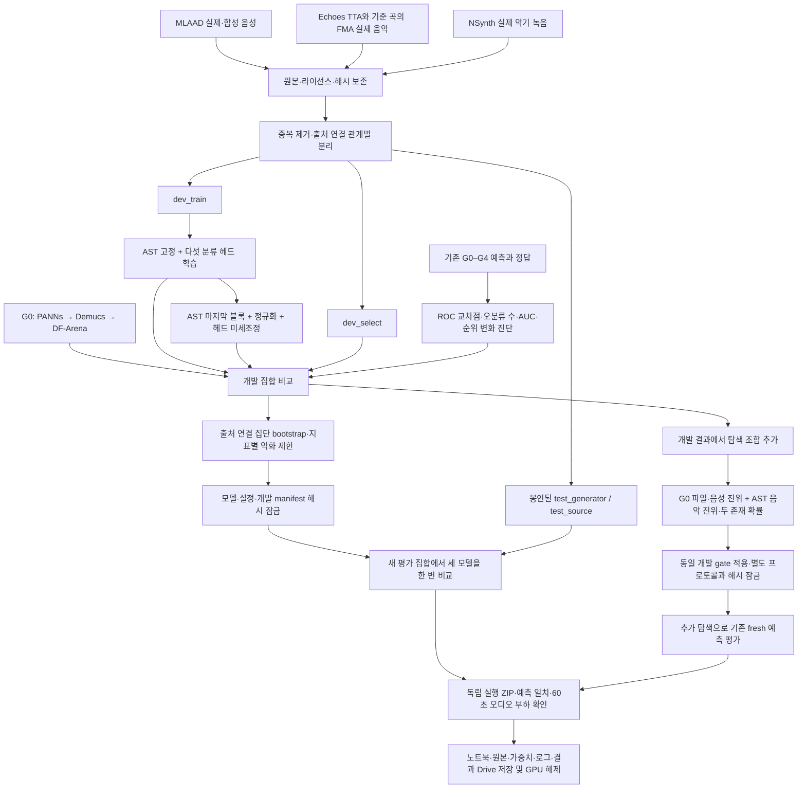

# DACON 236749: 성능 저하 진단과 AST 비교 실험

기존 225개 외부 검증 파일은 모두 개발 자료로 취급한다. 이미 결과를 확인한 65개 holdout으로 다시 모델을 선택하고 이를 독립 검증이라고 부르지 않는다. 새로운 음성 원문·음악 아티스트·악기 단위로 개발 자료와 두 평가 집합을 나눈다. 실제 실행 수치와 선택 결과는 `RESULTS_V2.md` 및 Drive 실행 폴더에 별도로 기록한다.

## 기존 결과에서 확인된 문제

| 비교 | 기존 holdout에서 확인한 변화 | 해석 범위 |
|---|---|---|
| G1 음성 | EER 0.041958 → 0.083916, AUC 0.980769 → 0.984266 | 순위 전체가 나빠진 것은 아니다. 공식 EER 교차점의 FP/FN이 각각 1개에서 2개로 늘었다. |
| G3 음악 | EER 0.307895 → 0.384211, AUC 0.721053 유지 | 개선된 순위 쌍과 악화된 순위 쌍이 상쇄돼도 EER 교차점은 바뀐다. |
| G4 파일 | 개발 EER 0.187500 → 0.143229, holdout 0.123476 → 0.156504 | 개발 집합의 이득이 이전 holdout으로 이어지지 않았다. 출처 편향이 유일한 원인이라고 단정할 수는 없다. |

이전 holdout 65개는 원자 출처 21개, 혼합 파일의 부모를 연결하면 독립적으로 재표집할 수 있는 연결 집단은 17개다. 클립 수를 그대로 표본 수로 보는 bootstrap은 불확실성을 과소평가할 수 있다. 이전 자료에는 음성 부재 정답도 없어 음성 존재 AUC를 계산할 수 없었다.

## 비교할 모델과 근거

| 후보 | 학습 범위 | 검증할 가설 |
|---|---|---|
| G0 | 기존 가중치와 계산 유지 | 현재 기준선의 성능을 동일한 새 자료에서 측정한다. |
| AST_FROZEN | AudioSet AST 표현 고정, 5개 출력 헤드 학습 | 음원 분리 없이 전체 음향 표현만으로 성분 존재와 생성 여부를 구분할 수 있는지 본다. |
| AST_LAST_BLOCK | 위 헤드에서 시작해 마지막 encoder 블록·최종 LayerNorm·헤드 학습 | 표현 일부를 실제·합성 구분에 맞추면 고정 표현보다 나아지는지 본다. |
| G0_AST_MUSIC | 추가 학습 없이 G0 파일·음성 진위와 AST 음악 진위·두 존재 확률을 고정 결합 | AST의 개발 음악 개선을 활용하면서 G0 음성·파일 출력을 보존한다. |

AST는 AudioSet에서 학습된 약 86.6M 파라미터 모델이다. 작은 학습 집합에서 전체 모델을 갱신하면 과적합과 비용이 커질 수 있어 마지막 블록부터 비교한다. 고정 표현 실험과 미세조정 실험은 같은 데이터·전처리·출력 구조를 사용한다. 학습되는 파라미터의 gradient와 가중치 변화도 기록해, 분류기 학습과 backbone 미세조정을 구분한다. [모델과 라이선스](https://huggingface.co/MIT/ast-finetuned-audioset-10-10-0.4593/tree/f826b80d28226b62986cc218e5cec390b1096902)

입력은 16 kHz 모노로 변환한다. 추론에서는 10초 이하 구간을 순서대로 나누고 마지막 구간까지 처리한 뒤 확률을 평균한다. 한 파일의 출력에 다른 파일의 예측이나 통계를 사용하지 않는다. 평균 집계는 짧은 합성 구간을 희석할 수 있으므로, 이번 비교의 고정된 한계로 기록한다.

정답이 없는 성분은 loss와 지표에서 제외한다. `VOICE_FAKE`와 `MUSIC_FAKE`는 해당 성분의 존재 정답이 1일 때만 학습한다. 음악의 제목·장르·프롬프트로 보컬 부재를 추정하지 않는다. NSynth의 실제 비음성 악기 녹음은 음성 부재 대조군이며 일반 음악 전체를 대표하지 않는다.

## 모델 선택과 예산

모델과 epoch 선택에는 `dev_select`만 사용한다. 계산 가능한 공식 지표의 가중치를 다시 정규화한 값은 **부분 정답 선택용 proxy**이며 DACON 점수가 아니다. G0 대비 proxy 개선 0.005 이상, 연결 집단 bootstrap 승률 0.70 이상, 개선량 10백분위수 −0.005 이상을 요구한다. 개별 EER 악화는 0.02, 대응 AUC 악화는 0.01 이내여야 한다. 기준을 통과하지 못하면 G0를 유지한다.

선택을 확정하고 모델·설정·개발 자료 해시를 저장한 뒤 새 평가 집합을 연다. 새 평가 결과로 후보를 재선택하거나 하이퍼파라미터를 바꾸지 않는다. 생성기와 원문이 학습에 없다는 것은 이번 실험의 데이터 분리를 뜻한다. 외부 사전학습 모델이 해당 데이터 계열을 전혀 본 적 없다는 뜻은 아니다.

데이터 다운로드와 CPU 검증, Drive 업로드를 끝낸 뒤 A100을 연결한다. 할당 시간은 최대 2시간이며 마지막 20분은 패키징과 저장에 남긴다. 오류가 나면 로그를 보존하고 런타임을 해제한다. A100에서 측정한 시간·메모리는 L4 서버의 60분 통과 증거로 해석하지 않는다.

## 실행에서 추가된 고정 조합과 정밀도 수정

원래 세 후보를 비교한 개발 선택은 G0로 남겼다. 개발 결과에서 AST 음악 EER은 크게 낮아졌지만 음성 EER은 악화됐기 때문이다. `G0_AST_MUSIC`은 root가 fresh 결과를 읽기 전인 2026-09-12 17:54:29 UTC에 별도 프로토콜로 등록했고, 17:56:42.639526 UTC에 개발 선택과 checkpoint hash를 잠갔다. 당시 원래 프로그램은 자체 선택 뒤 fresh 예측을 이미 생성하고 있었으므로, 네 후보를 모두 처음부터 등록한 실험이라고 서술하지 않는다. 원래 선택 기록과 추가 조합 기록을 따로 보존한다.

패키지 재실행에서는 새 프로세스의 cuDNN TF32 기본값 때문에 60초 입력의 확률 차이가 `2.2172927856445312e-05`로 측정됐다. 실제 A100에서 설정을 껐다 켜며 원인을 재현했다. AST 로딩 시 cuDNN·행렬곱 TF32를 모두 끄면 같은 가중치와 입력에서 차이는 `0.0`이다. `1e-5` 허용치는 유지했다. 최종 실험 수치와 ZIP 검증 범위는 [실행 보고서](/Users/choiwuseck/Documents/ChatGPT/데이콘/RESULTS_V2.md)에 기록한다.

원래 사전 등록 비교의 최종 선택은 G0로 유지한다. 추가 hybrid는 별도 탐색 결과로 보존하며, 원래 세 후보와 같은 사전 등록 검증으로 간주하지 않는다. 새로운 평가 자료가 생기기 전에는 이 결과로 독립 검증 개선을 확정하지 않는다.
