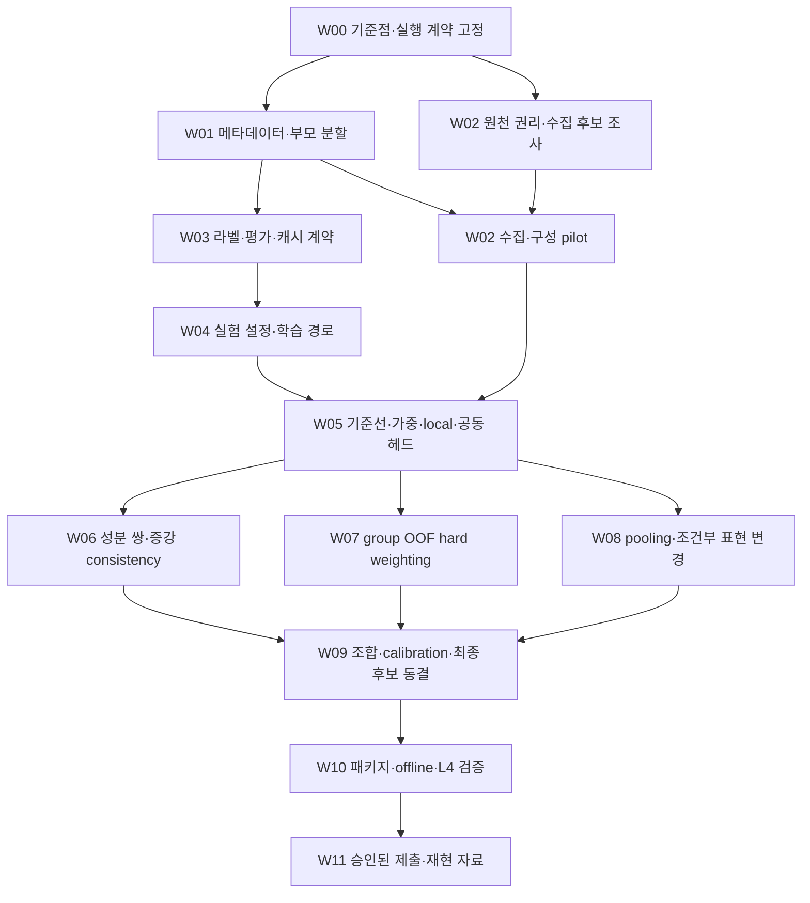

# DACON LB Improvement Workflow — Implementation Plan

> **For agentic workers:** 실행을 요청받으면 `superpowers:subagent-driven-development` 또는 `superpowers:executing-plans`로 아래 작업을 순서대로 수행한다. 이 문서는 실행 계획이며 GPU 작업·수집·제출을 시작하는 스크립트가 아니다. 체크박스는 실제 근거가 생긴 뒤에만 완료 처리한다.

**Goal:** 데이터·검증 오류를 수정하고, 음악·가창·혼합 진위·긴 발화의 약점을 개선하는 후보를 통제된 실험으로 선별해 재현 가능한 제출 패키지까지 연결한다.

**Architecture:** 현재 HTDemucs → DF-Arena/MERT → 작은 헤드 → presence/CDF 결합 경로를 기준으로 유지한다. 데이터 계약, 특징 캐시, 학습, 평가, 패키징의 경계를 먼저 고친 뒤 변경을 하나씩 비교한다. 효과가 확인된 변경만 합치며 새 백본·부분 fine-tuning은 조건부 후속 실험으로 둔다.

**Tech Stack:** 기존 Python 환경, NumPy, PyTorch, scikit-learn, FFmpeg, 프로젝트의 `data_v4`와 `full_bank_*` 코드. 새 오케스트레이션 프레임워크나 전역 의존성은 추가하지 않는다. 로컬 Python은 `.venv/bin/python`을 사용한다.

**Spec:** [감사 보고서](../../../DACON_LB_IMPROVEMENT_AUDIT_2026-09-24.md), [감사 증거](../../../../docs/evidence/lb_cpu_20260924/audit_findings_ledger.json), 이 문서의 추가 개선 계약 §2·§6. 과거 `data_v4/DESIGN.md`의 실행 상태와 라이선스 해석은 현재 사실로 재사용하지 않는다.

**실행 상태:** 이 문서는 실행 전 계획의 보존본이다. 이후 사용자가 CPU 작업·VESSL 업로드·지정 GitHub push를 승인했다. 현재 수행 결과와 제약은 [CPU 준비 기록](../../../../docs/CPU_PREPARATION_2026-09-24.md), [추가 수집 후 검토](../../../../docs/CPU_FOLLOWUP_2026-09-24.md), [신규 데이터 학습 편입](../../../../docs/CPU_ADMISSION_2026-09-24.md), [MLAAD 재검토](../../../../docs/MLAAD_DECISION_2026-09-24.md), [GPU 학습 준비](../../../../docs/GPU_PREPARATION_2026-09-24.md)을 따른다.

**계획 당시 상태:** 계획 작성 완료, 구현·수집·학습·제출 미실행. 계획 입력 HEAD는 `9acfce260ad70168df76ebd850c360fdb2ec12eb`이며 작업 트리에 기존 수정 9개가 있다. HEAD만으로 입력 전체를 식별하지 않는다.

## 1. Global Constraints

- 이번 요청은 workflow 작성이다. 아래 명령과 예산은 후속 실행 설계이며 실행·지출·제출 승인을 뜻하지 않는다.
- 기존 코드 수정, 원본 음원, manifest, checkpoint, 제출 ZIP을 보존한다. 원본 파일을 덮어쓰지 않고 새 실행 디렉터리를 쓴다.
- 기존 VESSL workspace `wsp-9683432r72m7`를 재사용한다. 실제 ID·장치·비용·스토리지·시작 설정을 확인하고 승인된 할당 범위에서만 기동한다. 새 workspace는 만들지 않는다.
- 스토리지 확인과 입력·bootstrap 업로드를 GPU 시작 전에 완료한다. 실행 중 5분 간격으로 상태·예산을 확인하고, 주기적으로 결과를 영구 저장소에 동기화한다. 종료 시 결과 확인·다운로드 후 compute를 중지한다. 재개해도 원래 deadline을 늘리지 않는다. [현재 CPU 작업 범위](../../../../docs/CPU_PREPARATION_2026-09-24.md)
- 학습은 train 역할만 사용한다. 원곡·화자·prompt·참조 음성·부모·중복 오디오로 이어지는 component는 서로 다른 역할로 나누지 않는다. 생성기 자체를 모든 행의 공통 parent로 연결하지 않는다.
- 성분 진위는 독립이다. `실제 보컬+AI 반주`는 VOICE real, MUSIC fake, FILE fake다. 알 수 없는 라벨은 마스크로 남긴다.
- 완전하지 않은 라벨의 참고 합산치를 공식 총점으로 부르지 않는다. 모든 결과에 ID 패널, 마스크, 클래스 수, 독립 component 수를 적는다.
- 비공개 평가 데이터로 학습·튜닝·pseudo-labeling을 하지 않는다. 추론은 파일별로 독립적이어야 한다. 파일 내 window 결합은 가능하나 다른 파일의 예측·통계로 보정하지 않는다. [공식 규칙](https://dacon.io/competitions/official/236749/overview/rules)
- 외부 자료는 파일별 출처·revision·학습/변환/제3자 제공 조건을 확인한다. 원본+증강 코드가 ND나 제공 제한을 자동 해소하지 않는다. [운영진 답변](https://dacon.io/competitions/official/236749/talkboard/417280)
- 추론 제한은 L4 22.4 GiB, 60분, 제출 ZIP 10GB다. 내부 목표는 45분 이내이며 실측 전에는 달성으로 표시하지 않는다. [평가 안내](https://dacon.io/competitions/official/236749/overview/evaluation)
- 모델이 바뀌지 않는 수정은 예측 동일성으로, 모델이 바뀌는 실험은 실제 오류 변화로 검증한다. 모양·파일 존재·테스트 개수만 확인하는 검증은 만들지 않는다.
- 각 완료 묶음은 관련 파일만 검토·stage·로컬 commit한다. push·공식 제출·배포는 포함하지 않는다.

## 2. 범위와 지금 확인된 추가 사실

| 개선 항목 | 담당 작업 | 처리 |
|---|---|---|
| 기준 제출·코드·예측·분모 식별 | W00, W03 | 필수 |
| Echoes 생성기 파싱, 중복·별칭, cap·가중 | W01, W05 | 필수 |
| 부모 먼저 분할, 같은 split 안에서 구성 | W01, W02 | 필수 |
| 성분별 마스크, HAIM 6행 제외 문제 | W03 | 필수 |
| 긴 발화·가창·미관측 원천·혼합 진위 평가 | W01, W02, W09 | 필수 |
| 데이터 권리 확인, 200–500개 pilot, 최대 4,400행 보강 | W02, W05/E04 | 필수 조사·pilot, 확대는 통과 조건부 |
| 실제 후처리 음성·전화채널·코덱·가창 라벨 점검 | W02, W06 | 필수 포함 |
| 기존 특징의 source/가창 가중, 공동 특징 헤드 | W05/E01·E03 | 독립 비교 |
| 가짜 음성 구간 정답과 local loss | W03, W04, W05/E02 | 독립 비교 |
| 성분 교체 쌍 학습, 변환 전후 consistency | W02, W06 | 독립 비교 |
| train 내부 group OOF hard-example 가중 | W07 | 독립 비교 |
| max/top-k/LME, 길이·부분 fake 대응 | W08/E08·E09 | 독립 비교 |
| raw+stem, 다층 MERT, 추가 백본 1개, 부분 fine-tuning | W08/E11–E14 | 조건부, 순차 비교 |
| checkpoint, ensemble, CDF calibration, 선택적 refit | W09 | 필수 선택 절차, refit 조건부 |
| 캐시·IO·파일 내부 batching·정밀도·MERT 후반층 | W03, W10 | 수치/시간 검증 뒤 적용 |
| 실제 패키지, offline, L4, 제출·결과 귀속 | W10, W11 | 최종 필수 |

추가 정적 검사와 실제 manifest 집계에서 `fake_voice_segments`가 있는 행은 **121개(train 101, val 18, test 2)**였다. `data_v4/export_bank.py:63`은 현재 music event만 내보내며 이 121행의 exported `event_intervals`는 모두 비어 있다. `full_bank_train.py:68,91`도 voice local truth/loss를 사용하지 않는다. 새 작업은 이 정보를 실제 학습까지 연결한다. **121행만으로 성능 개선이 보장되지는 않으며 기존 test 2행은 학습으로 이동시키지 않는다.**

`voice_original`은 raw 음성의 독립 예측이 아니다. `full_bank_features.py:211`에 저장되는 기존 classifier의 분리 stem 점수이고 silent이면 0이다. 이를 분리 실패 fallback으로 재사용하지 않는다. fallback 연구는 E11의 새 raw 경로가 준비된 경우에만 가능하다.

87건의 감사 항목을 모두 구현 대상으로 바꾸지 않는다. 검증되지 않은 50건은 연구 후보로 남기며 위 범위와 실제 실패 증거가 연결될 때만 작업으로 승격한다. Presence 백본 교체, 무조건적인 음악→VOICE 점수 복사, 고정 LB 전이율, 숨은 라벨을 역산하는 제출은 기본 실행 목록에서 제외한다.

## 3. 의존 관계와 담당



W06/W07/W08은 논리상 별도 비교지만 **GPU 작업은 한 번에 하나**다. 미실행 또는 탈락한 분기는 `deferred`/`rejected`로 이유를 남기면 W09로 진행할 수 있다. 데이터 조사와 CPU 문서·코드 검토만 병렬 처리한다.

| 담당 | 소유 파일/역할 | 병렬 제한 |
|---|---|---|
| Coordinator | run/후보 장부, 예산·승인 확인, 통합, commit, 최종 선택 | 유일한 실행 승인·GPU dispatcher |
| Data | `data_v4/build_manifest.py`, `split.py`, `export_bank.py`, `sources.py`, 생성기 코드 | 같은 파일의 W01/W02 수정은 순차 |
| Feature/Train | `full_bank_features.py`, `full_bank_train.py`, `full_bank_batches.py`, 필요한 기존 head 구현 | W03 캐시 계약이 잠긴 뒤 W04–W08 학습 구현 |
| Evaluation/Runtime | `full_bank_evaluate.py`, `data_v4/file_ensemble.py`, `decision_heads.py`, `full_bank_submission.py`, DataV4 packager/QA | 평가 함수·pooling 계약은 Train과 합의 후 한 담당만 수정 |
| Reviewer | diff·실제 산출물·수치·데이터 흐름 검토 | 구현자의 완료 선언이나 mock 결과만으로 통과시키지 않음 |

## 4. 공통 실행·데이터 계약

### 4.1 실행 상태와 경로

실행 시 루트는 `results/lb_improvement_20260924/`로 두고, 반복 실행은 `runs/<run_id>/` 아래 새 디렉터리를 만든다. 원격도 기존 `/shared/data-v4-20260923`를 덮어쓰지 않고 `/shared/lb-improvement-20260924/` 아래에서 수행한다. 아래는 **만들어야 할 산출물 계약**이며 현재 존재하는 파일로 간주하지 않는다.

- `baseline_lock.json`: 소스 commit+dirty patch 해시, 코드/asset/decoder/예측/manifest/ZIP 해시, 과거 노출 범위.
- `roles.csv`: `ID, component_id, role, historical_exposure, fold`. 역할은 `train, selection, calibration, development, sealed` 중 하나.
- `sources.jsonl`: 원천·파일 URL/revision/hash, 권리 문서, 원본/파생 연결, 사용 결론 `accepted/hold/rejected`와 이유.
- `experiment_matrix.csv`: E번호, 바꾼 한 항목, 데이터·캐시·설정 해시, 기준 run, 예산, 주지표·보호 슬라이스.
- `runs/<run_id>/run_identity.json`, `metrics.json`, `predictions.csv`, `runtime.json`, `decision.json`: 실제 실행과 판단 근거.
- `candidate_lock.json`: 최종 모델·seed·pooling·특징·calibration·runtime·입력 계약. 패키지가 이 lock과 다른 자산을 읽으면 실패.
- `workflow_state.json`: W/E ID별 `planned → ready → running → passed|rejected|deferred|blocked`. `passed`에는 실제 근거 경로·해시가 필수다. 파일만 생성했다고 통과시키지 않는다.

### 4.2 역할 분리

| 역할 | 허용 | 금지 |
|---|---|---|
| train | optimizer, pair loss, train 내부 OOF | 다른 역할의 label/통계로 gradient·가중 생성 |
| selection | epoch·checkpoint 선택 | optimizer, 최종 독립 성능 주장 |
| calibration | 잠긴 헤드의 CDF·결합 가중 적합 | 헤드 학습, 마지막 sealed 평가 대용 |
| development | 후보/조합 비교, 보호 슬라이스 분석 | 미사용 holdout이라고 부르기 |
| sealed | 모든 선택이 끝난 후보 1개와 기준선의 최종 비교 1회 | 결과를 본 뒤 epoch·가중·threshold를 다시 맞추기 |

기존 val/test는 이미 분석에 사용됐다. 기존 test 6,450행은 진단용 development로 유지하고 새 sealed라고 이름만 바꾸지 않는다. 새 sealed는 새로 확보한 자료 중 프로젝트 학습·선택에 쓰지 않은 원천/component에서 지정한다. 백본의 사전학습 노출 여부는 확인 가능한 범위만 별도 기록한다.

최초 배정은 기존 train을 train, 기존 test를 development로 유지하고, 기존 val의 component를 seed `20260924`로 selection/calibration에 약 1:1 배정한다. 비율보다 component 보존과 두 클래스·주요 콘텐츠의 확보를 우선한다. canonical 원곡 연결을 복원하면서 기존 역할 충돌이 발견되면 해당 component를 통째로 development로 격리하고 수량 변화를 기록한다. 새 학습 보강은 train, 새 평가 목표 600행은 sealed로 배정한다. paired 진단 자료는 development 역할의 부모로 별도 구성하며 4,400개 학습 행이나 600개 sealed에 중복 계산하지 않는다. 새로운 원천이 train과 sealed 양쪽에 들어가면 원천-held-out이라고 부르지 않는다.

새 평가 자료의 **계획 목표는 600행**, 학습 보강 4,400행과 별도다. 긴 발화, real/fake 가창, 두 혼합 진위 방향을 포함하고 역할 배정은 waveform·lineage·라벨을 확인한 뒤 모델 오답을 보기 전에 동결한다. 핵심 슬라이스에서 클래스당 독립 component 30개를 확보하지 못하면 그 슬라이스는 탐색 결과로 표시한다. 30개는 최소 운영 기준이지 좁은 신뢰구간의 보장이 아니다. 확보하지 못한 평가 범주를 보고하고 데이터·모델을 그 범주까지 검증했다고 주장하지 않는다.

기존 `split=train/val/test`와 호환이 필요하면 `role`을 별도 컬럼으로 보존한다. optimizer는 `role=train`만, epoch selector는 `role=selection`만 받도록 공통 검증한다. feature extractor는 평가 역할도 읽되 역할을 `val`로 위장하지 않는다. `bank_test_as_val.csv`는 과거 구현의 호환 방식이며 새 workflow에서 역할 경계를 대신하지 못한다.

### 4.3 평가와 채택 규칙

주지표는 고정된 공통 ID/마스크에서 `W = 0.5×File EER + 0.2×Voice EER + 0.3×Music EER`이며 낮을수록 좋다. presence AUC 두 개도 따로 보고한다. 라벨이 부족하면 `W_known_subset`으로 명명하고 공식 `score=null`을 유지한다. baseline과 candidate의 coverage가 다르면 먼저 교집합 비교와 전체 coverage를 분리한다.

각 E실험은 시작 전에 개선 대상과 보호 슬라이스를 등록한다. 보호 대상은 real 음악 FP, AI 가창 FN, real 보컬+AI 반주 VOICE FP, AI 보컬+real 반주 MUSIC FP, 긴 real/fake 발화, 전화채널이다. 존재하지 않는 성분의 진위 EER을 만들지 않는다.

**제안 채택 기준:** source/component 묶음을 함께 뽑는 paired bootstrap 2,000회로 ΔW의 95% 구간을 계산한다. ΔW<0이고 상한<0이며 목표 성분도 개선되면 3-seed 확인 대상으로 올린다. ΔW<0이나 구간이 0을 걸치면 `promising`으로 남기고 가장 유망한 2개까지만 재확인한다. 보호 슬라이스 FPR/FNR이 2%p 넘게 악화하면 채택을 보류하고 분모·오류 사례를 검토한다. 이 허용치는 계획상 위험 한도이며 경험적으로 입증된 최적값이 아니다. 표본 부족을 통과로 처리하지 않는다.

최종 후보는 development에서 하나로 고르고 calibration을 잠근 뒤 sealed를 한 번 연다. sealed 실패 시 확인된 기준선으로 복귀한다. 결과를 보고 고치면 그 sealed는 development로 전환하며 새 독립 자료 없이는 재검증 완료로 표시하지 않는다.

## 5. 작업별 workflow

### W00 — 기준점·실행 계약 고정

**입력:** 현재 작업 트리, 감사 보고서·증거, 기존 DataV4 ZIP/예측, 프로젝트 AGENTS. **소유:** Coordinator. **산출물:** `baseline_lock.json`, 최초 workflow 상태, 변경 파일 목록.

- [ ] branch/staged/dirty 상태를 확인하고 이번 작업과 기존 수정 9개를 구분한다. 구현할 때 다른 작업자의 최신 변경을 다시 확인한다.
- [ ] 원본 manifest·현재/패키지 runtime·checkpoint·asset·decoder·CSV·ZIP의 해시를 연결한다. 스크린샷 점수와 ZIP이 해시로 귀속되지 않았다는 한계를 유지한다.
- [ ] 저장 예측의 마스크를 적용해 File/Voice/Music EER과 presence AUC를 다시 계산한다. 저장 보고서와 `1e-12` 이내 일치해야 기준선으로 쓴다.
- [ ] workspace, 원격 환경, 다운로드 목적지, 남은 저장공간, GPU 시간 상한·deadline·종료 동작을 실제 할당과 대조한다. 승인되지 않은 자원은 기동하지 않는다.
- [ ] 오래된 `phase_a.sh/b.sh/c.sh`를 통째로 실행하지 않는다. 고정 `/shared` 경로, `rm -rf /data/code*`, 자동 GPU 병렬 추출, 과거 출력 덮어쓰기를 제거한 실행 설정을 먼저 준비한다.

**Gate:** 기준선 숫자·동일성·노출 이력이 설명되고 원본 복구 경로가 확보돼야 다음 단계로 간다. 코드·자료 해시 충돌은 중단 원인이다. 계획 문서의 생성은 이 gate 통과가 아니다.

### W01 — Echoes·중복·부모 분할 수정

**파일:** `data_v4/build_manifest.py`의 `ing_echoes/select_rows/components/plan_*`, `data_v4/split.py`, `data_v4/split_rules.json`. **소유:** Data. **산출물:** canonical source manifest, parent 역할표, generator/cap/중복 보고서.

- [ ] 실제 경로에서 `TTA/ATA` 다음의 생성기를 파싱하고 mode와 generator를 별도 식별한다. 알 수 없는 경로를 두 종류로 뭉개지 말고 제외 사유를 기록한다.
- [ ] Echoes 전장·레거시 crop의 원곡 별칭과 정확한 중복을 합쳐 component를 만든다. crop 오디오 hash가 달라도 같은 원곡이면 같은 역할이다. 생성기 단위 학습 cap과 leakage component는 구분한다.
- [ ] 기존 노출 이력을 보존하면서 부모 component에 역할을 먼저 배정한다. 하나의 부모라도 과거 학습·선택에 노출됐다면 연결된 component 전체에 그 이력을 전파한다. frozen presence head나 기존 CDF의 적합에 사용한 자료도 포함한다. 생성될 화자 참조·prompt·TTS/VC pair의 연결도 사전 포함한다.
- [ ] `plan_mixes/plan_songs/plan_splices/plan_enhanced`는 같은 역할의 부모만 선택한다. child는 부모 역할을 상속한다. 구성 후 component 검사는 누수 검사로만 쓰며 이미 배정한 부모를 대거 test로 이동시키지 않는다.
- [ ] 생성기별 선택 수와 `(label,source,generator)` 가중을 다시 집계한다. 실제 음악의 미기재 언어를 한국어 부재로 해석하지 않는다.

**검증:** 실제 Echoes의 서로 다른 생성기 경로를 구분하는 회귀 사례, legacy crop과 전장의 교차 역할 거부, cross-role parent pair 거부, 구성 전후 부모 역할 불변을 확인한다. 기존 594행 집계는 과거 자료의 회귀 기준이며 새 데이터에 594를 강제하지 않는다. 각 역할의 song/mix와 진위 조합 수를 출력한다.

### W02 — 권리 확인·신규 수집·쌍 데이터 pilot

**파일:** `data_v4/sources.py`, `candidate_data_acquire.py`, `data_v4/generate_speech.py`, `data_v4/generate_music.py`, `data_v4/build_manifest.py`. 기존 다운로더·생성기를 재사용하고 API 호환이 확인되지 않은 모델 이름을 끼워 넣지 않는다. **소유:** Data. 원천 조사만 W01과 병렬 가능, 실제 구성은 W01 통과 후.

- [ ] 원천별 허용 용도·변환·검증자 제공 조건과 실제 파일 revision/hash를 등록한다. Music Arena, FMA, MTG-Jamendo, 기존 권리 확인 자료를 후보로 두되 카드의 CC 표시만으로 최종 승인하지 않는다. CtrSVDD의 ND 충돌과 Emilia의 제공 조건이 풀리지 않으면 보류한다.
- [ ] 파일별 크기를 확인해 필요한 범위만 내려받는다. 한국어·상업 음악·실제 사람 발화 여부를 코퍼스 이름만으로 확정하지 않는다. 불명확한 성분 라벨은 검토하거나 마스크로 남긴다.
- [ ] 부모 분할 후 **최대 500행 pilot**을 만든다: 실제 음악100, 생성 음악100, 가창 real50+fake50, 네 혼합 조합 각25, 긴 발화 real50+fake50. 200행 시점에 중간 검사를 하고 문제가 있으면 500까지 확대하지 않는다.
- [ ] 혼합의 네 조합은 가능한 한 같은 보컬/반주 family, 길이, SNR, offset, codec 조건으로 만든다. `pair_id`, `voice_parent_id`, `music_parent_id`, 원본/변환 hash, offset, SNR, segment 위치와 변환 seed를 보존한다. 가창/발화와 동시/순차 혼합을 구분한다.
- [ ] 같은 부모의 원본/codec/gain 쌍을 만들고 시간 정렬을 확인한다. codec delay·자르기·리샘플링으로 위치가 달라지면 변환 offset을 기록해 구간 정답을 이동하거나 local supervision에서 제외한다.
- [ ] 실제 후처리 음성은 비생성적 잡음 제거·분리와 생성형 복원/편집을 구분한다. 새 음성이 생성된 경우까지 무조건 REAL로 라벨링하지 않는다. 단순 합성 경계만 탐지하는지 확인할 실제→실제 sham splice도 같은 fade/codec으로 만든다.
- [ ] pilot은 전수 metadata/lineage 검사와, 각 구성 범주 최소20행의 청취·구간 확인을 수행한다. 심각한 라벨·제공 권리 오류가 발견되면 해당 원천 전체를 재검토한다. 표본 청취를 전수 품질 보증으로 표시하지 않는다.
- [ ] pilot을 통과하면 아래 상한까지 부족 범주만 확대한다. 새 평가 자료와 원본 수·가수/화자/곡 수는 별도 집계한다.
- [ ] 학습 pilot·4,400행 보강과 별도로 **sealed 평가 목표 600행**을 확보한다. 긴 발화 real/fake, 가창 real/fake, real 보컬+AI 반주, AI 보컬+real 반주의 여섯 범주에 각100행을 우선 배정한다. 수량을 맞추기 위해 같은 원곡의 crop이나 단순 변형을 독립 표본으로 세지 않는다.
- [ ] sealed 원천·부모 component를 수집·생성 전에 따로 예약하고, 프로젝트의 과거 및 이번 train/selection/calibration/development 노출과 겹치는 component를 제외한다. 원천까지 분리한 범위와 component만 분리한 범위를 구분한다. waveform·권리·성분 라벨·구간 품질을 확인한 뒤 `roles.csv`와 ID/hash 목록을 잠그고 W09 전까지 예측·오류를 열지 않는다.
- [ ] 600행을 확보하지 못하면 실제 확보 수와 범주별 독립 component 수를 기록한다. §4.2의 최소 근거가 부족한 범주는 탐색 결과로 남기며, 독립 자료를 마련하지 못하면 `sealed unavailable`로 표시한다. 기존에 분석한 val/test로 대체해 독립 검증을 통과시키지 않는다. development의 성분 교체 진단 쌍은 development 부모로 별도 구성한다.

| 학습 보강 묶음 | 최대 파생 행 |
|---|---:|
| 실제 음악 | 1,000 |
| 현대 생성 음악 | 1,000 |
| 실제/AI 가창 | 400 + 400 |
| 보컬·반주 네 진위 조합 | 200 × 4 |
| 긴 실제/가짜 발화 | 400 + 400 |
| 합계 | **4,400** |

500행 pilot은 4,400행 안에 포함한다. 한 행이 여러 학습 목적을 가지면 중복 집계하지 않는다. sham·codec 쌍·후처리 대조군도 해당 묶음의 상한 안에 배정한다. 권리·품질·장르 수율이 낮으면 총량을 줄이고 부족분을 기록한다. 긴 발화는 15–60초 중 특히 30–60초 공백을 보완하며 단순 반복/이어붙이기를 자연 긴 발화와 섞지 않는다.

**Gate:** 원본·파생·권리·역할·성분 라벨을 추적할 수 있고 오디오와 구간의 정렬이 맞아야 feature 추출로 넘긴다. 학습 pilot과 sealed 준비 상태를 따로 기록한다. sealed 확보가 막혀도 학습 비교는 진행할 수 있지만 독립 검증 완료로 표시할 수 없다. 새로 수집했다는 사실 자체는 학습 효과의 증거가 아니다.

### W03 — 라벨·평가·캐시 계약 연결

**파일:** `data_v4/export_bank.py`, `full_bank_features.py`, `full_bank_evaluate.py`, `data_v4/file_ensemble.py`; 필요할 때만 `data_v4/promote_cache.py` 신설. `graph_scoring.py`의 기존 공식 마스크 계산을 재사용한다. **입력:** W01 역할표, W02/기존 manifest. **산출물:** 역할별 bank, supervision manifest, 검증된 cache mapping, baseline 재평가.

- [ ] `fake_voice_segments`와 구간 라벨 근거·완전성, pair/role 필드를 export한다. 현재 music `event_intervals`를 덮어쓰지 않는다. 가짜 구간 밖을 REAL로 둘 수 있는 것은 실제 carrier와 생성 절차가 확인된 constructed splice뿐이다.
- [ ] 음성 segment start/valid duration을 실제 `get_segment_starts/extract_segment`와 동일하게 연결한다. 4.04초 입력의 padding/repeat, 마지막 window overlap, codec delay를 반영한다. 구간이 일부 걸친 window는 점유율 보조 target으로 정의하고, 위치가 불명확하면 masked다. 파일 FAKE를 모든 window에 복사하지 않는다.
- [ ] FILE mask로 전체 예측 행을 제거하는 `file_ensemble.py` 경로를 고친다. 모든 ID의 다섯 출력을 보존하고 각 지표에 자기 마스크를 적용한다. VOICE/MUSIC 진위 평가는 해당 성분이 존재하는 행에만 적용한다.
- [ ] 과거 6,444-ID 패널에서 기존 수치 재현, 6,450-ID 출력에서 HAIM 6행의 MUSIC 평가 포함을 함께 확인한다. 누락된 FILE·VOICE 라벨은 그대로 미확인이다.
- [ ] **캐시 재사용을 명시적으로 설계한다.** 현 캐시는 전체 manifest·row·구현 hash에 묶인다. metadata 수정 후 기존 `index.json`의 hash만 바꿔 검사를 통과시키지 않는다.
- [ ] 캐시 재사용 후보마다 audio bytes, decoder/preprocessing/gain, window 배치, encoder weights/layer/dtype의 동일성을 검증한다. 모두 같으면 기존 embedding 배열을 새 namespace에 옮기고, 새 row/role/label binding과 local targets만 다시 생성한다. 기존 cache/member hash와 새 mapping을 연결하고 원본은 보존한다. encoder를 만든 revision과 새 supervision revision을 따로 기록한다.
- [ ] 오디오·전처리·레이어·window가 바뀌면 그 행/뷰를 다시 추출한다. global 통계 mean/scale은 새 train만으로 다시 적합한다. 메타데이터가 바뀌었다는 이유만으로 검증 없이 전량 재추출하거나, 반대로 무조건 재사용하지 않는다.
- [ ] 기존 cache가 실제 할당에 남아 있고 필요한 배열·identity가 읽히는지 확인한다. 없다면 전량 재추출 비용을 pilot으로 다시 산정한다. 복구라는 이유로 예산을 넘기지 않으며, 유효한 기준선까지 만들 예산이 부족하면 GPU 단계를 blocked로 남기고 CPU 수정·검토를 마친다.

**검증:** 실제 splice와 sham에서 구간/target 의미, 음악 정답만 있는 행의 denominator, waveform이 달라진 cache 거부, metadata만 바뀐 행의 embedding 일치, 평가 역할의 optimizer 진입 거부를 확인한다. cache 이전은 배열 hash 동일, FP32 학습/패키지 계산 parity는 `atol=1e-6, rtol=1e-5`를 기본으로 두되 기존 경로의 정확한 동일성이 가능하면 더 엄격하게 유지한다.

### W04 — 하나씩 비교할 학습·추론 설정 마련

**파일:** `full_bank_train.py`, `full_bank_batches.py`, `full_bank_evaluate.py`, `full_bank_submission.py`; 기존 `localization_models.py`/`decision_heads.py`의 관련 계산. **소유:** Feature/Train, 공통 runtime 계산은 Evaluation/Runtime과 조율. **산출물:** 실험 설정을 읽는 경로와 loss/gradient/parity 검증.

- [ ] 현재 trainer/evaluator/runtime의 고정 seeds `(41,42,43)`를 설정에서 읽게 하되 기본값은 유지한다. trainer만 1-seed로 바꾸고 evaluator가 세 checkpoint를 요구하는 상태를 만들지 않는다.
- [ ] `--experiment-config`를 trainer에 추가하고 엄격한 허용 키로 읽는다. 기본 설정은 기존 결과를 재현해야 한다. config·추가 loss·row weight·pair mapping·역할/선택 ID·seed·pooling을 `run_identity`와 checkpoint에 포함한다.
- [ ] 모든 optimizer loss의 입력은 train만, head normalization도 train만 사용한다. 검증/OOF row가 섞이면 gradient step 이전에 실패한다.
- [ ] local/pair/augmentation loss의 weight=0이면 기존 logits·gradient·update가 허용 오차 내 같아야 한다. 활성화하면 해당 실제 head에 유한한 nonzero gradient가 생기고 의도한 optimizer가 parameter를 바꿔야 한다. backbone은 동결 실험에서 gradient를 받지 않는다.
- [ ] 학습·캐시 평가·패키지에서 같은 pooling/feature order/label mapping을 사용한다. 저장 설정과 다른 기본값으로 조용히 복귀하지 않게 한다.

초기 설정 계약은 아래와 같다. **이 옵션은 아직 구현되지 않았다.** 기본값 밖의 수치는 아래 실험표의 사전 등록값만 사용하며 검증셋을 보면서 무제한 sweep하지 않는다.

```json
{
  "seeds": [41],
  "routes": ["music", "voice"],
  "voice_pooling": "max",
  "music_pooling": "lme",
  "voice_local_loss_weight": 0.0,
  "component_pair_loss_weight": 0.0,
  "augmentation_pair_loss_weight": 0.0,
  "row_weights_file": null,
  "head_variant": "existing"
}
```

**Gate:** seed 수 변경, loss off/on, microbatch 분할, mask, 실제 window/full-file 예측이 end-to-end로 연결돼야 E실험을 실행한다. 캐시 배열 크기 확인이나 mock head만으로 통과시키지 않는다.

### W05 — 기준선과 데이터·헤드 실험

**입력:** W01/W03/W04 통과, W02 pilot. **산출물:** E00–E04의 동일 패널 예측·metrics·비용. 최초 seed는 41, 최대50 epoch/patience5를 공통 상한으로 사용한다. 각 run의 optimizer update 수와 실제 본 행 수를 기록한다.

- [ ] E00은 수정된 메타데이터/역할에서 기존 모델·loss·pooling을 그대로 학습한 기준선이다. 기존 DataV4 패키지는 별도의 historical reference로 평가한다. 두 시스템의 데이터/학습 차이를 숨기지 않는다.
- [ ] E01–E03은 같은 E00 데이터와 epoch/optimizer 설정에서 한 요소만 바꾼다. E04만 데이터가 추가되는 비교다. 데이터 수가 달라 update 수가 변한 부분은 결과에 명시하고 필요하면 같은 update 예산의 대조군을 1회만 추가한다.
- [ ] E00의 헤드를 잠근 뒤 calibration 역할에서 기준 CDF를 적합해 `F0`로 고정한다. 모든 screening 후보는 이 같은 F0를 사용하는 결과와 성분별 EER을 함께 비교한다. W09의 최종 후보 전용 calibration 결과와 혼동하지 않는다. calibration은 헤드 학습·epoch 선택에 쓰지 않는다.
- [ ] 후보마다 §4.3의 gate를 적용하고 증거/탈락 이유를 기록한다. 다음 후보를 위해 기준선 설정을 덮어쓰지 않는다.

| E ID | E00에서 바꾸는 것 | 첫 비교 설정 | 보호할 실패 |
|---|---|---|---|
| E00 | 없음, 수정된 데이터 계약의 기준선 | 기존 head/loss/max·LME | 수치·입력·seed 재현 |
| E01 | 원천·가창/발화 가중 | 가창/발화 × label 셀을 균형화하고 기존 source/generator 가중을 셀 안에서 정규화; 전체 class 총량 유지 | 작은 셀/별칭 과대 가중, 발화 퇴행 |
| E02 | voice local loss | 확인된 window 점유율 target, BCE 보조 weight **0.25** | 부분 fake 미탐, sham 경계 지름길, real FP |
| E03 | 공동 특징 작은 헤드 | 각 component head에 같은 파일의 다른 경로 평균 특징을 추가; 기존 독립 label 유지, 새 backbone 없음 | 반주 fake가 VOICE로 새는 오류와 역방향 |
| E04 | 승인·검수된 추가 데이터 | W02 pilot 뒤 필요한 범주를 최대4,400행까지, 기본 loss/head 유지 | source 지름길, real 음악 FP, 기존 도메인 퇴행 |

0.25는 현재 music local loss와 같은 첫 실험값이며 최적값으로 주장하지 않는다. E03은 우선 파일 단위 집계로 비교하므로 시간 정렬을 이용한 모델이라고 부르지 않는다. 시간 정렬 모델로 확대할 때는 별도 실험으로 등록한다.

### W06 — 성분 쌍·증강 consistency

**파일:** `full_bank_train.py`, `full_bank_batches.py`, 필요 시 `data_v4/build_manifest.py`의 pair export 보완. **입력:** W02의 승인된 pair·W04. **산출물:** E05/E06 별도 후보. pair가 batch에 함께 들어오도록 실제 batching 경로에 연결한다.

- [ ] **E05 성분 쌍:** 같은 보컬과 다른 반주인 쌍에서는 VOICE logit 차이에, 같은 반주와 다른 보컬인 쌍에서는 MUSIC logit 차이에 SmoothL1 보조 loss를 준다. 바뀐 성분은 각 실제 진위 정답의 supervised BCE로 구분하게 하며 FILE까지 같은 값을 강제하지 않는다. 첫 weight는 **0.1**이다. 기존 pair helper가 두 행의 모든 라벨이 같다고 가정하는지 확인하고 그대로 가져오지 않는다.
- [ ] 보컬이 묻히거나 separator가 근거를 소실한 쌍은 엄격한 동일 점수 목표에서 제외한다. valid pair 여부는 생성 provenance와 사전 정의한 가청성/라벨 검사로 정하고 모델이 맞혔는지로 고르지 않는다. matched SNR·offset·codec 조건을 유지한다.
- [ ] **E06 증강 쌍:** 같은 내용/진위의 원본과 약한 codec/gain 변형에서 성분 logit consistency를 weight **0.1**로 적용한다. 원본 supervised BCE를 유지해 모든 출력을 같은 값으로 만드는 해를 막는다. 강한 손상·시간 불일치·성분 소실은 consistency 대상에서 제외한다.
- [ ] E05/E06은 각각 같은 데이터의 pair loss OFF 대조군과 비교한다. 행 수·음원 자체가 바뀐 효과와 loss 효과를 섞지 않는다.

**Gate:** 실제 pair에서 목표 head의 gradient/update를 확인하고, 고정 dev의 성분 교체 판정·codec 전후 안정성·기본 EER을 함께 본다. consistency만 좋아지고 진위 구분이 나빠지면 탈락이다. test/sealed pair는 loss 계산에 넣지 않는다.

### W07 — group OOF hard-example 가중

**파일:** `full_bank_batches.py`, `full_bank_train.py`; `data_v4/compare_runs.py`의 ID 결합/보고 기능 재사용. **입력:** 기준 레시피·train component. **산출물:** fold mapping, OOF 예측, bounded weight 파일, E07.

- [ ] train만 component 기준 **3 folds**로 나눈다. fold를 뺀 데이터로 헤드와 mean/scale을 적합한다. held-out fold는 normalization·checkpoint 선택·CDF fitting에도 쓰지 않는다. epoch는 내부 selection 또는 미리 고정한 recipe로 정한다.
- [ ] 3개의 seed41 fold 모델로 각 train 행의 미학습 예측을 한 번씩 얻는다. fixed pretrained encoder는 공유하되 프로젝트 데이터로 fine-tuning한 encoder라면 fold마다 다시 학습하거나 이 실험을 보류한다.
- [ ] label 확인을 통과한 오답에만 기본 weight 대비 최대 **2배** 가중을 주고 class/source 총량을 다시 정규화한다. 하나의 원곡이 crop 수만큼 과대 반영되지 않게 component 기여를 제한한다.
- [ ] E07을 동일 데이터·loss의 OFF 기준과 비교한다. OOF를 만든 모델 자체의 score를 개선 결과로 보고하지 않는다. 합성 경계·결측 라벨·분리 실패를 계속 틀리는 샘플이라는 이유로 강하게 학습하지 않는다.

**Gate:** 각 OOF 행이 자기 학습/선택/정규화 집합에 없음을 source ID까지 추적하고, 실제 오류율·원천별 편차가 개선됐는지 §4.3으로 판정한다. in-sample 가중은 자동으로 데이터 누수인 것은 아니지만 과적합·오라벨 확대 위험이 있어 이 workflow에서는 사용하지 않는다.

### W08 — pooling과 조건부 표현 변경

**파일:** `full_bank_train.py`, `full_bank_evaluate.py`, `full_bank_submission.py`, `full_bank_features.py`, 기존 head 구현. **입력:** 긴 발화·부분 fake·혼합 진위 dev, 앞 단계의 예산 잔여. **산출물:** 채택/탈락 근거가 있는 E08/E09와 조건부 E11–E14.

- [ ] **E08:** voice max 대신 상위30% window logit 평균(최소1개)을 학습·평가·추론에 동일하게 적용한다.
- [ ] **E09:** voice에 `logsumexp(logits)-log(n)`을 적용한다. 음악의 기존 LME는 고정한다. E08/E09는 기존 window embedding을 쓸 수 있지만 학습 head와 runtime pooling은 다시 검증한다.
- [ ] 긴 real FP가 줄어도 짧은 부분 fake FN이 늘면 채택하지 않는다. 샘플 길이별 비교에 source/content 구성도 함께 보고한다.
- [ ] **E11 raw+stem:** 동일 원본의 raw 특징을 새로 추출하고 원래 stem 경로와 결합한다. silent fallback도 여기서만 진단한다. 기존 `voice_original`을 raw 점수라고 사용하지 않는다.
- [ ] **E12 다층 MERT:** L6/L12/L24의 고정 선택부터 시작한다. 같은 입력·window에서 추출하고 현재 L12-only와 비교한다. cache에 없는 층을 이미 계산한 특징으로 취급하지 않는다.
- [ ] **E13 추가 백본:** 앞 단계가 설명하지 못한 실패를 목표로 공개 checkpoint 한 개만 선택한다. 라이선스·가창/전화채널 적합성·ZIP 크기·실행 시간을 먼저 확인한다. 논문 fine-tuned 수치를 zero-shot 성능으로 인용하지 않는다.
- [ ] **E14 부분 fine-tuning:** 실패 영역과 독립 평가가 명확하고 예산이 남을 때만 상위층 일부 또는 LoRA 중 하나를 고른다. 첫 probe는 최대1시간, 전체 stage 예산 안에서만 확대한다. 전체 백본·새 loss·새 데이터를 동시에 바꾸지 않는다.

E11–E14는 **순서대로 다음 필요성을 판단**하며 자동 전부 실행하지 않는다. 효과가 없거나 runtime/권리/예산/마감 gate를 통과하지 못하면 이유를 남겨 deferred 처리한다. stereo·overlap·TTA는 해당 단계의 우선 후보보다 명확한 실패 근거가 있을 때만 한 항목을 대체하며 실험 수를 늘리지 않는다.

### W09 — 조합, checkpoint·ensemble·calibration, 최종 잠금

**파일:** `full_bank_evaluate.py`, `data_v4/file_ensemble.py`, `decision_heads.py`; trainer의 선택 기록. **입력:** 독립 비교 결과, W02의 역할·ID/hash가 잠긴 sealed 자료와 준비 상태. **산출물:** 최종 `candidate_lock.json`, calibration, sealed 검증 결과.

- [ ] 단일 비교에서 통과한 최대3개 변경만 합친다. **E10 조합은 최대2개**로 제한하고, 이미 붙인 변경에 다음 변경을 더했을 때 효과가 남는지 확인한다. 각각 통과했다고 조합도 통과한 것으로 보지 않는다.
- [ ] 가장 유망한 후보 최대2개만 seeds41/42/43으로 확인한다. 기존 seed41 결과를 재사용할 수 있을 때 중복 학습하지 않는다. seed별 점수와 평균 예측의 EER을 구분한다.
- [ ] checkpoint는 selection에서 고르고 모델 조합은 development에서 결정한다. calibration에서는 그 잠긴 모델들의 CDF·결합 계수만 적합한다. 현재 CDF/max/noisy-or 구현을 먼저 재사용하며 새 복잡한 meta-model을 기본으로 추가하지 않는다.
- [ ] 단독 성분 EER, 최종 FILE EER, 가중 W를 모두 확인한다. EER은 단조 점수 변환만으로 좋아지지 않으므로 temperature/Platt 자체를 성분 EER 개선책으로 주장하지 않는다. 유용성은 결합 결과에서 확인한다.
- [ ] 최종 후보 하나·입력·구현·학습 recipe·calibration을 잠근 뒤 sealed에서 기준선과 한 번 비교한다. 기준 미달이면 확인된 기준선으로 복귀한다.
- [ ] W02의 독립 자료·역할 동결을 확인하지 못하면 sealed 평가는 실행하지 않는다. `sealed unavailable`과 남은 검증 범위를 기록하고 확인된 기준선을 유지한다. development 개선만으로 최종 독립 검증 통과를 선언하지 않는다.
- [ ] **선택적 refit:** 기본은 평가 역할 보존이다. refit을 택하면 recipe/epoch를 먼저 잠그고 새 헤드가 학습하지 않은 calibration을 유지한다. 전체 행을 학습한 뒤 그 행 예측으로 CDF를 맞추지 않는다. upstream부터의 group OOF 대안은 계산·검증 예산이 확보된 경우에만 쓴다. 새 헤드와 맞지 않는 기존 CDF를 무검증 재사용하지 않는다.

**Gate:** 최종 모델·features·fusion의 해시와 어느 자료로 무엇을 선택/적합했는지가 추적돼야 한다. sealed를 보고 수정했다면 독립 확인 상태를 취소한다.

### W10 — runtime 최적화·패키징·L4

**파일:** `full_bank_features.py`, `full_bank_submission.py`, `package_datav4_submission.py`, `verify_datav4_submission.py`, 필요 시 공유 asset/member 검증 helper. **산출물:** 새 경로의 ZIP/manifest, reference parity, offline·L4 receipt.

- [ ] 특징 추출의 매 행 전체 `index.json` 저장을 줄이되, 완료된 cache의 재시작/손상 검출을 유지한다. local scratch에 임시 WAV를 쓰고 검증된 결과만 영구 저장소로 옮긴다. resume 실패나 재처리 비용을 측정한다.
- [ ] 같은 파일 내부 segment batching, 지원되는 낮은 정밀도, MERT 미사용 후반층 제거를 하나씩 측정한다. `hidden_states[12]`와 마지막 layer norm을 확인 없이 12층에서 잘라내지 않는다. 다른 파일을 섞은 normalization/보정은 사용하지 않는다.
- [ ] FP32 참조 대비 예측 parity를 확인한 뒤, 낮은 정밀도처럼 정확한 동일성이 불가능한 변경은 실제 EER/보호 슬라이스/시간/VRAM을 측정해 별도 채택한다. CPU bf16 오차를 GPU fp16의 상한으로 주장하지 않는다.
- [ ] **DataV4 packager를 매개변수화한다.** 현재 `package_datav4_submission.py`는 HEADS/PRESENCE/OUTPUT가 과거 경로로 고정돼 있다. 새 `--candidate-lock --base-archive --output` 계약으로 출처·자산·seed/head/특징 개수를 검증하고 새 ZIP을 만든다. 기존 제출 ZIP을 덮어쓰지 않는다. 7,144행을 강제하는 `package_full_bank_submission.py` 검사를 삭제해 억지로 통과시키지 않는다.
- [ ] runtime에 필요한 모듈·pooling/config/추가 특징·calibration을 explicit allowlist로 넣는다. archive member 경로·중복·hash·압축 해제 크기·entrypoint·dependencies를 확인한다. 새 모듈이 필요한데 예전 base ZIP에서 누락되지 않도록 실제 패키지 경로를 실행한다.
- [ ] `verify_datav4_submission.py`도 input ZIP/output QA 경로를 받도록 바꾼다. 현재 old-vs-new presence 변화나 `not max`만 확인하는 조건은 이번 후보의 목표 동작·reference parity 검사로 교체한다.
- [ ] 실제 원본 음원에서 최종 CSV까지 network 차단·빈 model cache·Linux decoder로 실행한다. speech/music/song/두 hybrid/긴 발화/전화/부분 fake/sham/무음·매우 약한 보컬/mono·stereo/wav·flac·mp3를 포함한다. 예측 행을 역순·subset으로 바꿔도 동일 파일 출력이 변하지 않아야 한다.
- [ ] 부모 프로세스 모델을 해제하고 CUDA 메모리를 비운 뒤 패키지 subprocess를 시작한다. H100/CPU 완료를 L4 확인으로 표시하지 않는다. 승인된 L4 할당이 없으면 `L4_UNVERIFIED`로 남기며 새 유료 장치를 자동 생성하지 않는다.

**Gate:** 실제 candidate ZIP 해시와 reference inference parity, 파일 독립성, offline 동작, 유한한 다섯 출력·정확한 ID가 연결돼야 한다. L4의 공개 입력 패널로 처리량·peak VRAM을 기록하고 60초 파일 위주 부담 조건도 측정한다. hidden 전체 소요 시간은 공식 실행 전 미확인이며 외삽은 추정으로 표시한다.

### W11 — 제출·재현 자료·종료

**소유:** Coordinator. **입력:** W09/W10의 잠긴 후보와 명시적인 제출 승인. **산출물:** `submission_receipt.json`, 최종 변경/결과 보고, 보존된 재현 자료.

- [ ] 실제 제출 대상 대회·계정·ZIP·해시와 남은 제출 횟수를 확인한다. 공식 한도는 하루3회지만 이 문서가 현재 남은 횟수를 안다는 뜻은 아니다. [규칙](https://dacon.io/competitions/official/236749/overview/rules)
- [ ] 승인된 ZIP만 제출한다. 성공 여부가 애매하면 제출 목록을 확인하고 중복 제출하지 않는다. LB에서 보이는 total/ADS/CPS/runtime과 ZIP hash의 연결 근거를 함께 저장한다.
- [ ] 숨은 파일별 라벨을 추정하거나 숨은 데이터로 학습하지 않는다. 제출 슬롯은 근거가 있는 모델 비교에 쓰고 빈 슬롯을 채우려고 임의 변형을 만들지 않는다.
- [ ] 학습에 쓴 원본·파생 파일, 권리/출처, 생성 설정, splits/roles, 코드·환경·checkpoint·calibration을 explicit 목록으로 보존한다. 실제 HWP 2종의 작성·공식 전달은 그 작업을 요청받았을 때 전용 skill로 처리하되 필요한 근거는 지금부터 축적한다.
- [ ] 검증된 결과 다운로드와 workspace 중지를 확인하고 실제 commit·원격 작업 상태·남은 미확인 항목을 보고한다. 자동 백그라운드 실행을 약속하지 않는다.

## 6. Review Focus — 반드시 보호할 실패

| 실패 상황 | 의미 있는 관측·검증 | 담당 |
|---|---|---|
| Echoes 별칭과 crop이 다른 역할에 배정됨 | 실제 parent/audio 계보로 교차 역할을 검출·거부 | W01 |
| 누수 방지 closure가 모든 구성 노래를 test로 이동시킴 | 부모 역할 불변, 구성 후 범주/role 수, cross-role construction 거부 | W01/W02 |
| codec delay·tail padding 때문에 voice 구간 라벨이 틀어짐 | 실제 삽입/변환 음원과 복원 segment 시간의 대응, 모르는 구간은 masked | W02/W03 |
| 새 loss가 계산만 되고 학습에 연결되지 않음 | 실제 head gradient·optimizer update, frozen backbone 무gradient, loss OFF parity | W04/W06 |
| label/split만 바꾼 캐시 또는 원본이 바뀐 캐시를 잘못 재사용 | audio/preprocess/encoder identity와 supervision binding 분리·검증 | W03 |
| OOF 모델·정규화·epoch 선택에 자기 fold가 들어감 | fold별 fitted ID 및 selection ID 교집합0, upstream 범위 검증 | W07 |
| FILE 결합 개선이 VOICE/MUSIC 성분 의미를 훼손함 | 두 hybrid 방향의 성분별 FP/FN 및 전체 FILE 비교 | W05/W06/W09 |
| 새 seed/pooling/head가 평가·ZIP에서 옛 기본값으로 돌아감 | 실제 checkpoint/config 로드와 reference→패키지 수치 parity | W04/W10 |
| subset/order/무음 때문에 파일 독립성이 깨짐 | 실제 extracted script의 전체·역순·부분집합 결과 비교 | W10 |
| CPU/H100 결과를 L4·LB 결과로 혼동함 | 장치/입력/시간·ZIP hash·공식 제출 근거를 분리한 receipt | W10/W11 |

기존 `test_full_bank_training.py`와 `eight_contract.py`, `check_voice_music_h100.py`의 관련 계약을 먼저 재사용한다. 새 회귀 검증은 데이터 경로와 학습 경로의 실제 실패를 묶어 소수로 추가한다. 위 의미 있는 결과를 검사하지 않는 단순 파일 존재·shape·hard-coded 상수 검사는 추가하지 않는다. 정확한 command와 허용 오차는 해당 구현 diff와 함께 기록한다.

## 7. 현재 명령과 구현 후 명령 구분

아래 기존 CLI는 코드에서 확인한 문법이다. **그대로 과거 경로에 실행하라는 지시가 아니며**, 실행자가 W00에서 잡은 새 경로를 전달한다. shell 인수는 실제 경로로 안전하게 quoting하고 remote Python은 기존 환경의 실제 interpreter를 확인한다.

| 작업 | 현재 지원하는 진입점·옵션 |
|---|---|
| 부모 ingest/선택/전처리/보컬/구성 | `data_v4/build_manifest.py ingest/select/materialize/vocals/construct` — split-aware 구성은 W01 구현 필요 |
| split 분석·배정·검사 | `data_v4/split.py analyze --manifest --report`, `apply --manifest --rules --out`, `verify --manifest --splits` |
| bank export | `data_v4/export_bank.py --manifest --splits --out` |
| 특징 추출 | `full_bank_features.py --manifest --input --cache --output --assets --asset-hashes` |
| 현재 학습 | `full_bank_train.py --manifest --cache --output --max-epochs 50 --patience 5 [--duration-balance]` — 현재 seeds 고정 |
| 기존 CDF 결합 | `data_v4/file_ensemble.py --bank --test-bank --cache --test-cache --train-dir --presence-head` — 현재 val fitting/test 평가 결합 경로 |
| 현 DataV4 패키징/QA | `package_datav4_submission.py`, `verify_datav4_submission.py` — 현재 경로 고정, W10 전 새 후보에 실행하지 않음 |

W01/W03/W04/W09/W10에서 새 역할·config·candidate-lock 옵션을 구현하고 `--help`와 실제 읽는 파일을 함께 검토한다. 특히 `file_ensemble.py`는 **calibration fit**과 **다른 역할의 score**를 분리하는 `fit/score` subcommand를 추가한다. 현재 CLI가 이미 이를 지원한다고 가정하지 않는다. 필요 기능은 기존 CLI에 국소적으로 추가하며 별도 범용 workflow engine은 만들지 않는다.

## 8. 자원·실험 수·중단 조건

다음은 **제안 상한**이다. 실행 전에 사용자가 승인한 실제 할당/금액/시간 한도와 맞춰 더 작은 쪽을 적용한다. GPU 없이 가능한 코드·자료 검토는 먼저 끝낸다. 다운로드에도 원천별 bytes와 저장 여유를 확인하며 대용량 전체 archive를 무조건 받지 않는다.

| 묶음 | H100 경과 GPU 시간 상한 제안 | 범위 |
|---|---:|---|
| 생성·보컬 근거·pilot | 1.5시간 | 가벼운 실제 샘플 확인 후 제한 확대 |
| 새 행/필요한 view 특징 추출·캐시 검증 | 3시간 | 기존 embedding 재사용 gate 우선 |
| E00–E09·OOF·최대2개 조합·3-seed 확인 | 2.5시간 | 시간 도달 시 후보 우선순위로 중단 |
| 재현·복구 여유 | 1시간 | 의미 있는 실패 원인 수정 1회까지 |
| 핵심 workflow 합계 | **8시간** | 계획값, 실행 승인 아님 |
| E11–E14 선택적 표현 연구 | **추가 최대4시간** | 별도 잔여 예산/시간이 확인된 경우만 |

실제 pipeline 비용은 pilot에서 다시 잰다. 과거 특징 단계의 19.25 audio-hour/경과시간1시간에는 일반 분리와 cache IO가 포함됐으므로 분리를 다시 전부 더하지 않는다. 4,400행×평균22초의 약1.40시간은 그 조건의 외삽일 뿐 새 runtime 보장이 아니다. sealed 목표600행과 development 진단 쌍의 추출도 위 3시간 상한에 포함해 다시 산정한다. 생성·추가 구성 분리·전송·자료 검사는 별도 비용으로 같은 전체 예산 안에 반영한다.

GPU job은 한 개씩 실행한다. 실패한 run 자동 반복은 하지 않으며, 원인과 수정이 확인된 infrastructure 실패에 한해 같은 원래 deadline 안에서 1회 재시도한다. 성능이 나쁘다는 이유로 seed·hyperparameter를 계속 바꾸지 않는다. 예산·저장소·누수·라벨·권리·성분 퇴행·패키지 parity 중 하나가 gate를 깨면 해당 단계만 중단하고 근거를 보존한다.

## 9. 일정과 마감 경로

공식 표기는 **2026-09-29 10:00 제출 마감**이다. 본문에 시간대가 별도 명시되지 않아 아래는 KST 기준 작업 계획이며 실행 전에 실제 계정 마감 표시를 확인한다. [공식 일정](https://dacon.io/competitions/official/236749/overview/schedule)

| 날짜 | 필수 경로 | 병렬/조건부 |
|---|---|---|
| 9/24 | W00–W01, W03 데이터/캐시/평가 계약 구현 | W02 권리·원천 조사 |
| 9/25 | W02 pilot, 역할 고정, W04, E00 | 신규 데이터는 권리·검수 통과 범위만 준비 |
| 9/26 | E01–E04 및 E05/E06 | E07 OOF를 예산 안에서 순차 |
| 9/27 | E08/E09, E10 조합, 유망 후보 3-seed | E11–E14는 필수 경로를 지연시키지 않을 때만 |
| 9/28 | W09 동결·sealed, W10 패키지/실측 | **18:00 이후 새 학습·의존성·구조 변경 중단** |
| 9/29 | 승인된 제출과 W11 영수증, **09:00까지 완료 목표** | 마지막1시간을 복구 여유로 확보 |

실행 시작이 늦어지면 선택적 표현 변경 → 덜 유망한 loss 비교 → 4,400행 확대 순으로 축소한다. **권리·누수·라벨 검증과 최종 패키지 검증을 생략해 일정을 맞추지 않는다.** 원래 허용 예산과 마감 안에 실제 L4 검증이 불가능하면 그 한계를 공개하고 이미 확인된 패키지를 유지한다.

## 10. 실행 시작 시 첫 체크리스트

- [ ] 최신 작업 트리와 이 계획 입력의 차이를 확인한다. 기존 변경을 덮어쓰지 않는다.
- [ ] W00의 기준·역할·자원 계약부터 만든다. 오래된 phase script나 고정 경로 packager는 실행하지 않는다.
- [ ] W01 Echoes/분할, W03 구간 정답·마스크·캐시 계약을 우선 구현·검토한다.
- [ ] W02 권리 조사와 200행 중간검사까지 준비하고, GPU가 필요한 단계는 확정된 입력·예산·deadline 이후 실행한다.
- [ ] E00 기준선이 재현되기 전에는 여러 개선을 함께 켜지 않는다.

완료 보고에는 실행한 W/E ID, 실제 데이터 수·원천 수, 기준 대비 수치·분모·불확실성, 탈락/보류 이유, GPU 사용, ZIP/제출 귀속, commit과 남은 미확인을 적는다. 계획된 작업을 완료된 개선으로 보고하지 않는다.
