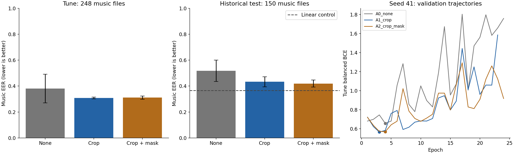

# H100 학습 입력 증강 비교 결과

**실험 완료. 결과 다운로드·무결성 검증 후 H100 Pause를 확인했고, 3분 간격 모니터도 종료했다.** Workspace `wsp-yiuufw51tke8`은 `stopped`, 계정 과금 속도는 0이다.

9개 temporal 모델과 동일 분할 Linear 비교를 완료했다. 노트북 실행 시간은 **169.7초, 약 2분 50초**다. 실행 전후 계정 잔액 차이는 **0.325298 크레딧**, 잔액은 **11.555556 크레딧**이다. 이 차이에는 GPU 시작·준비·학습·결과 확인·다운로드 시간이 포함된다.

## 결과

EER는 낮을수록 좋다. 각 증강 조건은 seed 41·42·43의 평균과 모집단 표준편차다.

| 조건 | 튜닝 EER 평균 | 튜닝 seed 표준편차 | 기존 평가 EER 평균 | 평가 seed 표준편차 |
|---|---:|---:|---:|---:|
| A0_none | 0.3808 | 0.1100 | 0.5176 | 0.0820 |
| A1_crop | 0.3082 | 0.0074 | 0.4333 | 0.0386 |
| A2_crop_mask | 0.3110 | 0.0128 | 0.4194 | 0.0272 |

동일 분할 Linear의 기존 평가 Music EER는 **0.3667**, 공식 베이스라인은 **0.5528**이다. 증강으로 평균 평가 EER와 seed 편차가 줄었지만 세 seed 모두 Linear의 음악 EER에는 못 미쳤다. 튜닝 자료로 선택한 조건은 **A1_crop**이다. 기존 평가에서 A2_crop_mask 평균이 더 좋다는 이유로 선택을 바꾸지 않았다.

A1_crop의 best epoch는 seed별 3·5·4이고, A2_crop_mask는 4·5·4다. 증강 후에도 학습을 이어가면 튜닝 손실이 커지는 현상은 남았다. 과적합 해소나 리더보드 개선을 확정할 수 없다. 기존에 확인한 공개 평가 자료를 재사용한 비교다.

## 조건

- A0_none: 증강 없음.
- A1_crop: 70% 확률로 입력보다 짧은 3·4·6·8·12개 중 가능한 연속 캐시 구간을 추출한다. 유효 음악 구간이 남는 위치만 선택한다.
- A2_crop_mask: 같은 crop 설정과 30% 확률의 특징 마스킹. 768차원 중 38개를 가린다.
- batch 128, T0 6층 residual Conv1D, lr 3e-4, Dropout 0.2, weight decay 0.01, AdamW, gradient clipping 1.0.
- 최대 300 epoch, early stopping patience 20, min_delta 1e-4. 최저 튜닝 BCE 가중치를 복원한다.
- 튜닝 EER의 세 seed 평균 → 표준편차 → BCE 평균 순으로 조건을 선택한다.
- 1,446개 원본 특징 캐시를 재사용했으며 음원 혼합·잡음 변형·MERT 재추출은 이번에 적용하지 않았다.

## 파일과 검증

- `Temporal_H100_Augmentation_Report.ipynb`: 실행된 노트북의 결과 출력은 유지하고 맨 위 요약만 완료 상태로 정리한 보고용 사본.
- `unpacked/Temporal_H100_Augmentation_Executed.ipynb`: 서버에서 저장한 원본 실행 노트북. 코드 셀 5개 실행, 오류 0개, 실제 PNG 출력 포함.
- `Temporal_H100_Augmentation_results.zip`: 15,456,389바이트. SHA256 `024815081d5ac3780898ad37eaf5f7c015868f1f7979be8ee5fb224e08f58b50`.
- `download_verification.json`: ZIP 크기·SHA256·CRC·안전한 추출 경로 검증.
- `result_verification.json`: 9개 checkpoint SHA256, 실제 batch와 update 수, best epoch 복원, 설정 고정, 입력 명세, 증강 적용 횟수 검증.
- `pause_verification.json`, `billing_after_pause.json`: 정지 상태와 과금 속도 0 확인.

증강 없는 세 seed의 학습·튜닝 손실 곡선이 이전 batch 128 결과와 오차 1e-6 이내로 일치했다. 원본·품질 마스크 적용 캐시는 학습 후에도 변하지 않았다. 공식 베이스라인과 Linear의 파일별 예측도 이전 결과와 일치했다. 저장된 그래프의 축·범례·출력 내용을 시각적으로 확인했다.

일반 실행기가 결과 ZIP에서 `.txt` 파일을 제외하므로 `unpacked/requirements-head.txt`는 입력 ZIP에서 그대로 복사하고 입력 명세 해시를 확인했다. 원본 결과 ZIP은 변경하지 않았다. 결과 보존 대상은 object volume `objvol-a5gxdg7er70i`의 `/temporal/h100-aug-20260915`이며, 로컬 다운로드를 검증한 후 Pause했다.

