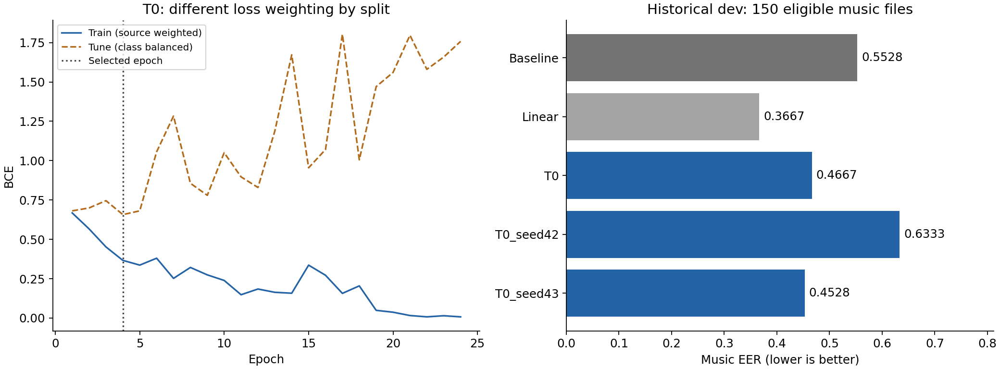

# H100 batch 128 재실험 결과

**실험 완료, 결과 다운로드·무결성 검증 완료, H100 Pause 확인 완료.** 3분 간격 모니터도 종료했다. 워크스페이스 `wsp-yiuufw51tke8`의 상태는 `stopped`, 계정 과금 속도는 0이다.

노트북 실행 시간은 **237.9초, 약 3분 58초**였다. 직전 정지 시점과 이번 종료 시점의 계정 잔액 차이는 **0.343557 크레딧**, 남은 잔액은 **11.880854 크레딧**이다. 잔액 차이에는 GPU 시작·준비·실험·결과 확인·다운로드 시간이 포함되며, 학습 계산만의 비용은 아니다.

## 주요 결과

EER는 낮을수록 좋다. 아래 평가는 과거에도 사용한 공개 dev 자료다.

| 모델 | 튜닝 Music EER | 기존 평가 Music EER | 기존 평가 File EER |
|---|---:|---:|---:|
| 공식 베이스라인 | — | 0.5528 | 0.4321 |
| 동일 분할 Linear | 0.3627 | **0.3667** | 0.3519 |
| batch 16 최선 설정 T7, seed 41 | 0.3499 | 0.5472 | 0.3801 |
| batch 128 최선 설정 T0, seed 41 | **0.3030** | 0.4667 | 0.3679 |
| batch 128 T0, seed 42 | — | 0.6333 | 0.4160 |
| batch 128 T0, seed 43 | — | 0.4528 | 0.3321 |

8개 조합 모두 batch 16보다 튜닝 Music EER가 좋아졌다. 다만 batch 128의 세 seed 평균 평가 Music EER는 **0.5176**, 표준편차는 **0.0820**이었다. 이전 batch 16의 평균 0.5667보다 낮아졌지만, 표준편차 0.0237보다 편차가 커졌다. 현재 temporal 모델을 Linear보다 안정적으로 우수하다고 볼 근거는 부족하다. File EER가 좋은 seed 43을 평가 점수만 보고 선택하지 않았다.

이번에 튜닝 자료로 선택한 설정은 **T0: batch 128, lr 3e-4, Dropout 0.2, weight decay 0.01, AdamW**다. 최대 300 epoch, early stopping patience 20, min_delta 1e-4 조건에서 24 epoch를 학습했고, 최저 튜닝 BCE를 기록한 **4 epoch 가중치**를 복원했다. 총 update는 192회, 선택된 가중치까지는 32회다.

## 과적합 해석

T0의 튜닝 BCE는 4 epoch에서 **0.6571**로 가장 낮았지만 마지막에는 **1.7579**로 커졌다. 마지막 학습 손실은 **0.00736**이었다. 배치를 키운 뒤에도 학습을 이어가면 검증 성능이 악화되는 현상이 남았다. 학습 손실은 출처별 가중치, 튜닝 손실은 class-balanced 가중치이므로 둘의 절대 차이를 그대로 일반화 오차로 해석하지 않는다.

기존 T0의 best epoch 2는 126 update였고, 이번 T0의 best epoch 4는 32 update다. epoch가 늘었다는 이유만으로 과적합이 늦게 생겼다고 판단할 수 없다. 또한 최선 설정이 T7에서 T0로 바뀌었으므로, 위 최선 모델 간 차이를 특정 설정에서의 순수한 배치 효과라고 해석해서는 안 된다.

학습 자료의 길이와 혼합·편집 자료 구성은 바꾸지 않았다. 그 분포 차이는 여전히 남아 있다. 데이터 조건을 맞추는 후속 비교가 필요하지만, 이번 종료 후 새 실험은 시작하지 않았다.

## 같은 설정에서의 배치 비교

| 설정 | batch 16 튜닝 EER | batch 128 튜닝 EER |
|---|---:|---:|
| T0 | 0.4794 | 0.3030 |
| T1 | 0.4794 | 0.3058 |
| T2 | 0.4168 | 0.3343 |
| T3 | 0.3912 | 0.3443 |
| T4 | 0.3627 | 0.3158 |
| T5 | 0.3627 | 0.3058 |
| T6 | 0.3599 | 0.3315 |
| T7 | 0.3499 | 0.3186 |

이전 노트북 실행은 약 125.2초였다. 이번에는 약 237.9초가 걸렸으므로 배치 확대가 전체 실행 시간을 줄인 결과는 아니다. GPU 평균 사용률은 측정하지 않았다.

## 결과 파일과 검증

- `unpacked/Temporal_H100_Executed.ipynb`: 코드 셀 5개 모두 실행 완료, 오류 0개. 표와 실제 PNG 출력 포함.
- `Temporal_H100_results.zip`: **16,880,451바이트**, SHA256 `047cbb62c75802609bc067a9ab917adb95f9a733b56011dce93d5e93d9fb85fb`.
- `download_verification.json`: 크기·SHA256·ZIP CRC·안전한 추출 경로 확인.
- `pause_verification.json`, `billing_after_pause.json`: 정지 및 과금 속도 0 확인.
- `comparison.json`: 이전 결과와의 비교 및 검증 기록.
- `unpacked/results/`: 후보별 최선 가중치, 전체 학습 곡선, 튜닝 선택 기록, 평가 예측과 지표.

분할·데이터 정제 계획·캐시 명세·베이스라인 입력이 이전 실행과 같은 바이트인지 확인했다. 베이스라인과 Linear의 파일별 예측도 이전 결과와 허용 오차 1e-6 이내로 일치했다. 10개 temporal 학습의 실제 batch 128 적용, update 수, 최선 epoch 복원, checkpoint 해시와 평가 전 설정 고정 기록도 검증했다. 새 리더보드 제출이나 독립 외부 평가를 수행한 결과는 아니다.

CLI 스토리지 목록 API 시간 초과 때문에 입력 약 459KB만 Jupyter로 직접 전송했다. 기존 1,446개 특징 캐시를 재사용했으며 대용량 원본 음원은 다시 업로드하지 않았다. 결과는 object volume `objvol-a5gxdg7er70i`의 `/temporal/h100-b128-20260915`에도 보존하도록 실행 스크립트를 구성했다. 로컬 다운로드의 무결성 검증을 마친 뒤 Pause했다.
