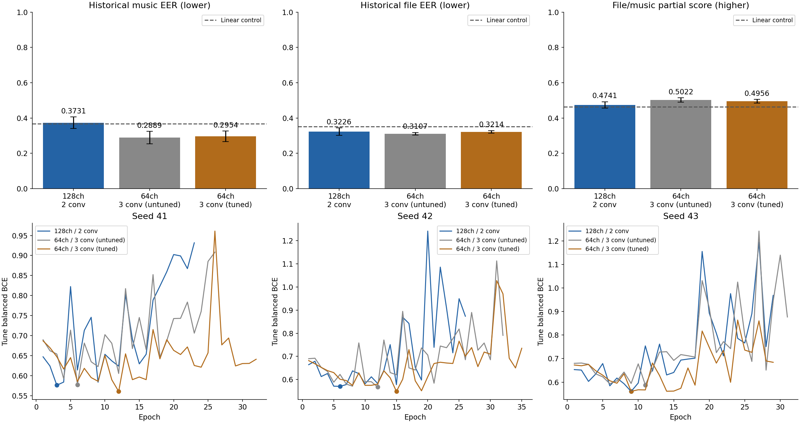

# H100 64채널·Conv1D 3층 튜닝 결과

GELU를 유지하고 채널을 128→64, 시간축 Conv1D를 2→3층으로 바꿨습니다.
파라미터는 199,169→88,257개로 55.7% 줄었습니다.
24개 설정의 1차 탐색, 상위 4개 seed 반복, 대조군을 합쳐 37회 학습을 완료했습니다.

| 모델 | 튜닝 Music EER ↓ | 평가 Music EER ↓ | 평가 File EER ↓ | 파일·음악 가중 부분합 ↑ |
|---|---:|---:|---:|---:|
| 기존 128채널·2층 | 30.06% | 37.31% | 32.26% | 0.4741 |
| 64채널·3층 / 튜닝 전 | 31.34% | 28.89% | 31.07% | 0.5022 |
| 64채널·3층 / 튜닝 선택 C08 | 27.55% | 29.54% | 32.14% | 0.4956 |

모든 Conv1D 수치는 seed 41·42·43 평균이며 낮은 EER이 좋습니다.
64채널·3층으로 구조만 바꿨을 때 기존 모델보다 평가 Music EER은 8.43%p,
File EER은 1.20%p 낮아졌습니다. 채널 수와 층 수를 함께 바꿨으므로 각각의 효과는 분리할 수 없습니다.

튜닝 데이터로 선택한 C08은 튜닝 Music EER을 31.34%→27.55%로 낮췄지만,
평가 Music EER은 튜닝 전 C00보다 0.65%p, File EER은 1.07%p 높았습니다.
이번 결과에서는 추가 튜닝이 평가 EER을 더 낮추지 못했습니다.
평가 BCE는 C00 0.6176→C08 0.6046으로 낮아졌으므로 모든 지표가 나빠진 것은 아닙니다.
C08 선택은 평가 전에 고정했으며, 평가 결과를 보고 C00이나 특정 seed로 바꾸지 않았습니다.

기존 공개 평가 자료를 재사용한 결과입니다. 전체 공식 점수나 리더보드 성능을 입증하지 않습니다.

## 선택한 설정 C08

| 항목 | 값 |
|---|---|
| 입력 | 고정 MERT-v1-95M의 기존 768차원 캐시 |
| 구조 | LayerNorm(768) → kernel-1 입력 투영(768→64) → 시간축 Conv1D 3층 → residual 합산 → masked max → Linear(64,1) |
| 시간축 Conv1D | 64채널, kernel 3, dilation 1, 층마다 LayerNorm → Conv1D → GELU → Dropout |
| 활성화 | GELU 유지; residual 합산 직후 활성화 없음; 추론 출력만 Sigmoid |
| optimizer | AdamW |
| learning rate | 0.0001 |
| batch size | 64 |
| weight decay | 0 |
| dropout | 0 |
| crop 적용 확률 | 0.7; 허용된 전체 곡 라벨에만 적용 |
| 특징 마스킹 적용 확률 | 0.3; 적용 시 MERT 특징 차원의 5%(38차원)를 가림 |
| NSynth 손실 가중치 | 0; NSynth 샘플의 직접적인 손실 기여가 0 |
| gradient clipping | 1.0 |
| 최대 epoch / patience / min_delta | 300 / 20 / 0.0001 |
| seed별 선택 epoch | 41: 12, 42: 15, 43: 9 |

GELU와 max pooling은 탐색 대상에서 제외했습니다. 각 학습에서 최소 튜닝 BCE 가중치를 복원합니다.
Dropout과 weight decay가 0인 설정이 선택됐지만 crop과 특징 마스킹은 남아 있습니다.
여러 하이퍼파라미터를 함께 바꾼 탐색이므로 개별 항목의 기여를 단정할 수 없습니다.

## 탐색 범위와 선택 절차

| 항목 | 탐색 값 |
|---|---|
| learning rate | 0.00003, 0.0001, 0.0003, 0.001 |
| weight decay | 0, 0.001, 0.01, 0.05, 0.1 |
| dropout | 0, 0.1, 0.2, 0.35, 0.5 |
| batch size | 32, 64, 128, 256 |
| crop 적용 확률 | 0, 0.35, 0.7, 1 |
| 특징 마스킹 적용 확률 | 0, 0.15, 0.3 |
| NSynth 손실 가중치 | 0, 0.025, 0.05, 0.1 |

1. 튜닝 전 설정 C00과 고정 난수로 만든 23개 조합을 seed 41에서 비교했습니다. 전체 조합을 전수 탐색한 것은 아닙니다.
2. 튜닝 Music EER→BCE→이름 순으로 상위 C08·C05·C21·C19를 고정했습니다.
3. 상위 4개와 C00을 seed 42·43에서 반복하고, 기존 S128도 세 seed에서 학습했습니다.
4. 상위 4개 중 튜닝 Music EER 평균→모집단 표준편차→BCE 평균→이름 순으로 C08을 선택했습니다.
5. 선택 파일을 고정한 뒤 C08·C00·S128의 세 seed와 공식 baseline·Linear를 기존 평가 자료에서 비교했습니다.

학습 1,008개, 튜닝 248개, 평가 190개를 유지했습니다. 평가 음악 EER 대상은 150개입니다.
음성·존재 확률을 유지하고 음악 확률 및 이에 따른 파일 max 결합만 바꿨습니다.
파일·음악 가중 부분합은 `0.45*(1-File EER)+0.27*(1-Music EER)`이며 전체 공식 점수가 아닙니다.

## Seed별 결과

| 모델 | seed | Music EER | File EER | best epoch | 종료 epoch |
|---|---:|---:|---:|---:|---:|
| S128 | 41 | 41.94% | 35.19% | 3 | 23 |
| S128 | 42 | 35.28% | 30.00% | 6 | 26 |
| S128 | 43 | 34.72% | 31.60% | 9 | 29 |
| C00 | 41 | 33.33% | 31.60% | 6 | 26 |
| C00 | 42 | 24.72% | 30.00% | 12 | 32 |
| C00 | 43 | 28.61% | 31.60% | 11 | 31 |
| C08 | 41 | 31.39% | 31.60% | 12 | 32 |
| C08 | 42 | 25.28% | 31.60% | 15 | 35 |
| C08 | 43 | 31.94% | 33.21% | 9 | 29 |

후반 튜닝 손실 상승은 남아 있습니다. C08의 각 seed에서 최소 BCE는 약 0.5610·0.5484·0.5611,
마지막 BCE는 0.6412·0.7351·0.6843입니다. 과적합이 해결됐다고 볼 수 없습니다.
C08의 튜닝 EER 표준편차는 0.0106으로 C00의 0.0298보다 작았습니다.

## 실행 비용과 종료

H100 workspace는 stopped, phase standby이며 계정 과금 속도는 0입니다.
잔액 11.095577→10.296535, 총 0.799042크레딧을 사용했습니다.
비용에는 초기화·환경 설치 재시도·학습·요청한 3분 간격 확인 대기·다운로드·정지까지 포함됩니다.

## 검증과 보존

- 추가한 세 번째 Conv1D와 나머지 파라미터의 유한한 비영 gradient, GELU/residual/max 연산, 패딩 독립성, 실제 학습 후 저장·재로딩을 확인했습니다.
- 37개 체크포인트의 해시·구조·파라미터·선택 epoch·optimizer step·학습 및 튜닝 ID를 대조했습니다.
- 저장한 튜닝 예측 37개와 평가 결과 11개의 지표를 다시 계산했습니다. 지표 허용 오차는 1e-12입니다.
- 기존 S128의 세 seed 학습 곡선과 평가 예측을 이전 H100 결과와 1e-6 이내로 재현했습니다.
- 분할·입력 해시·캐시 불변성과 평가 전 후보 선택 고정을 확인했습니다.
- 실행 노트북은 코드 셀 5개를 오류 없이 완료했습니다. 결과 비교와 세 seed 학습 곡선을 시각적으로 확인했습니다.

성공한 노트북의 코드 셀 실행 구간은 484.9초(약 8.1분)입니다.

처음 재시작된 기본 환경은 Python 3.14.6이어서 고정 SciPy 설치가 실패했습니다.
학습 시작 전에 Python 3.13.9와 PyTorch 2.9.1+cu130 환경으로 맞췄으며 데이터·탐색 설정은 바꾸지 않았습니다.
초기 설치 실패 로그와 수정한 bootstrap을 함께 보존했습니다.
결과 ZIP은 16,272,724바이트이며 SHA256은 `d1686131f56829d0ce96beebc77e9ba213c7be2d8e2e82c73128ccb906507fdc`입니다.
크기·해시·CRC·추출 경로를 확인했습니다. 원격 object storage에도 결과를 보존했습니다.

```sh
OMP_NUM_THREADS=1 MKL_NUM_THREADS=1 .venv/bin/python results/temporal_h100_compact_20260915/verify_results.py
```

보고용 노트북은 첫 요약 셀만 갱신한 사본이며 실행 코드와 출력은 원본 그대로입니다.
원본은 `unpacked/Temporal_H100_Compact_Tuning_Executed.ipynb`입니다.


