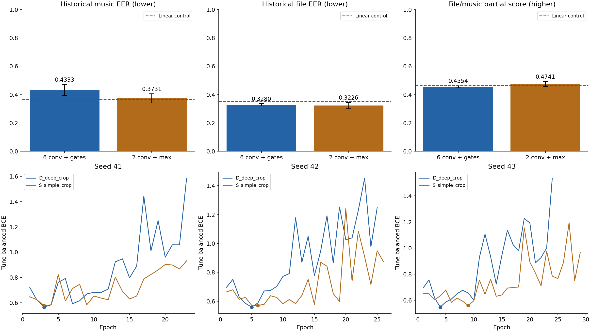

# H100 음악 분류기 단순화 실험 결과

실험과 결과 검증을 완료했습니다. H100은 stopped, 계정 과금 속도는 0입니다.

| 구조 | 파라미터 | 평균 Music EER ↓ | 평균 File EER ↓ | 파일·음악 가중 부분합 ↑ |
|---|---:|---:|---:|---:|
| 기존 6층 + gated attention/max | 414,017 | 0.4333 | 0.3280 | 0.4554 |
| 단순화 2층 + max | 199,169 | 0.3731 | 0.3226 | 0.4741 |
| 동일 분할 Linear, seed 41 | 769 | 0.3667 | 0.3519 | 0.4626 |

Conv1D 결과는 seed 41·42·43 평균입니다. 단순화 후 Music EER은 6.02%p,
File EER은 0.53%p 낮아졌습니다. 파일·음악 가중 부분합은 전체 공식 점수가 아닙니다.
기존 공개 평가 자료를 재사용했으며, 평가 결과로 좋은 seed만 고르지 않았습니다.

Music EER의 seed 표준편차는 0.0386→0.0328로 줄었지만 File EER은 0.0086→0.0217로 늘었습니다.
단순화 모델의 최선 epoch는 3·6·9였으며 학습 후반의 튜닝 손실 상승은 남았습니다.
평균 튜닝 EER은 0.3082→0.3006으로 낮아졌지만 평균 튜닝 BCE는 0.5577→0.5691로 높아졌습니다.
이 결과만으로 과적합이 해결됐거나 모든 지표가 안정적으로 개선됐다고 볼 수는 없습니다.

기존 입력·분할·crop 70%·batch 128·학습 설정을 유지했습니다.
기존 모델의 세 seed 학습 곡선과 평가 예측은 이전 H100 기록을 오차 1e-6 이내로 재현했습니다.

성공한 노트북의 코드 셀 실행 구간은 100.2초입니다.
시작 잔액 11.555556→종료 잔액 11.095577, 계정 차감은 0.459979크레딧입니다.
차감액에는 첫 시도, 원인 확인, 재실행, 다운로드와 정지 전 대기가 포함됩니다.
첫 시도는 기존 분기의 연산 순서 변경으로 재현성 검증에 실패했고, 순서를 복원한 뒤 재실행했습니다.

## 변경 범위

- dilation 2·4 residual block을 제거하고 dilation 1 block 하나(Conv1D 2층)를 남겼습니다.
- gated attention과 attention/max 연결을 제거하고 유효 구간 max pooling만 사용합니다.
- 출력층은 Linear(256, 1)에서 Linear(128, 1)로 줄였습니다.
- MERT·768차원 입력 LayerNorm·128차원 투영·남은 residual 연결·Dropout을 유지합니다.
- crop 70%, 특징 마스킹 없음, AdamW lr 3e-4, weight decay 0.01, clipping 1.0,
  최대 300 epoch, patience 20, min_delta 1e-4를 유지합니다.
- 기존 구조와 단순화 구조는 같은 seed별 셔플·crop을 사용합니다. 학습 종료 epoch가 다른 경우 공통 epoch 구간을 대조했습니다.
- 두 구조는 초기화할 파라미터 수와 Dropout 연산 수가 다릅니다. 모든 난수가 구조 사이에 동일한 실험은 아닙니다.

## Seed별 평가

| seed | 기존 Music EER | 단순화 Music EER | 기존 File EER | 단순화 File EER |
|---|---:|---:|---:|---:|
| 41 | 0.4333 | 0.4194 | 0.3321 | 0.3519 |
| 42 | 0.3861 | 0.3528 | 0.3359 | 0.3000 |
| 43 | 0.4806 | 0.3472 | 0.3160 | 0.3160 |

음악 EER은 세 seed 모두 낮아졌습니다. 파일 EER은 seed 41에서 악화, seed 42에서 개선,
seed 43에서 동일했습니다. 최저 음악 EER만으로 seed를 골라 제출하지 않았습니다.

## 평가 범위

학습 1,008개, 튜닝 248개, 기존 평가 190개를 유지했습니다. 음악 EER의 평가 대상은 150개입니다.
기존 음성·존재 확률과 파일 max 결합식을 유지하고 음악 확률만 교체했습니다.
가중 부분합은 `0.45*(1-File EER)+0.27*(1-Music EER)`입니다.
음성 정답 누락과 음성 존재 AUC 계산 불가 때문에 전체 점수는 `null`입니다.
후보 선택 기록은 이전과 같은 튜닝 Music EER 기준이며 최종 대회 제출 모델 선정은 아닙니다.
이번 변경은 층 수와 pooling을 함께 바꿨으므로 각각의 효과를 분리해서 입증하지는 않습니다.

## 검증과 보존

원본 실행 노트북은 `unpacked/Temporal_H100_Simplification_Executed.ipynb`이며 변경하지 않았습니다.
보고용 사본은 첫 요약 셀만 완료 상태로 정리했습니다. 코드 셀 5개가 모두 실행됐고 오류 출력은 없습니다.
체크포인트 6개의 SHA256·파라미터·실제 batch와 update 수·최선 epoch 복원을 검증했습니다.
저장된 예측으로 8개 모델·참조의 지표를 다시 계산해 허용 오차 1e-12 내 일치를 확인했습니다.
정답 누락·평가 대상 수 등 메타데이터도 일치합니다. 플랫폼 간 AUC 차이 약 4e-16은 위 허용 오차 안입니다.
원본 캐시와 정제 마스크가 학습 후에도 같고, 기존 baseline·Linear 예측도 이전 결과와 일치합니다.
그래프의 수치·축·범례와 seed별 곡선을 확인했습니다.

ZIP은 8,575,811바이트, SHA256 `a0741308a3744c9d94e62052c0a0d7a85a7fdbc66df1d8a9ae24a5ee91749d8d`입니다.
크기·해시·CRC·추출 경로 검증 후 H100을 Pause했습니다.
`requirements-head.txt`는 공통 실행기의 ZIP 대상에 없으므로 입력 번들에서 복사하고 해시를 검증했습니다.

첫 시도는 `attempt1/`에 보존했습니다. 순전파 출력이 같아도 gradient 합산 순서 변경으로 차이가 생겼습니다.
회귀 검증은 수정 전 실패, 복원 후 통과했으며 재실행에서는 이전 H100 학습 곡선까지 재현됐습니다.
원격 보존 경로는 object volume의 `/temporal/h100-simple-20260915-retry1`입니다.

```sh
OMP_NUM_THREADS=1 MKL_NUM_THREADS=1 .venv/bin/python results/temporal_h100_simple_20260915/verify_results.py
```


