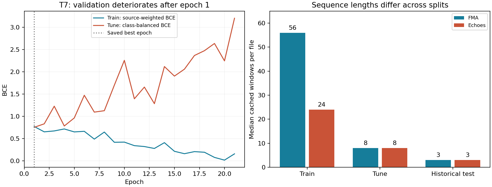

# 배치 크기 변경과 과적합 진단

배치 기본값을 **16 → 128**로 바꿨다. 학습·튜닝 추론·최종 평가에 실제 설정이 전달되고, 후보 및 epoch 진행 기록에 optimizer update 수를 남긴다. 수정한 노트북은 `Temporal_H100_Tuning.ipynb`, `Temporal_Conv1D_Tuning.ipynb`다. 학습률 후보 `3e-4 / 1e-4`, Dropout `0.2 / 0.4`, weight decay `0.01 / 0.05`, early stopping patience 20은 유지했다. 이번에는 H100을 다시 켜거나 새 학습을 돌리지 않았다.

진단에는 이전 H100 실험의 실제 캐시 1,446개와 저장된 최선 가중치를 사용했다. CPU에서 다시 추론한 T7 튜닝 확률이 원래 H100 예측과 절대 오차 `1e-6` 이내로 일치했다. `diagnosis.json`에 집계값, `predictions.csv`에 파일별 예측, `diagnose.py`에 재현 코드를 남겼다.



## 확인된 현상

| 항목 | 실제 측정값 | 해석 |
|---|---|---|
| T7 학습 곡선 | 1 → 21 epoch: 학습 BCE 0.7723 → 0.1592, 튜닝 BCE 0.7548 → 3.2021 | 학습을 계속할수록 튜닝 손실이 커진다. 가장 낮은 튜닝 BCE는 1 epoch다. |
| T0 학습 곡선 | 마지막 학습 BCE 0.0000277, 마지막 튜닝 BCE 4.2607, best epoch 2 | 학습 자료에 매우 강하게 맞추면서 검증 성능이 악화됐다. |
| T7 최선 가중치 | Music EER: 학습 0.1458, 튜닝 0.3499, 기존 평가 0.5472 | early stopping으로 마지막 가중치를 피했어도 일반화 문제가 남는다. |
| 같은 분할의 Linear | Music EER: 튜닝 0.3627, 기존 평가 0.3667 | T7은 튜닝 EER만 조금 우세하고, 평가에서는 더 나쁘다. |
| 튜닝 확률 품질 | balanced BCE: T7 0.7548, Linear 0.6064 | T7의 튜닝 EER 우세를 전반적인 성능 개선으로 해석할 수 없다. |

학습 손실은 출처별 가중치와 Dropout이 적용된 미니배치 손실의 합이고, 튜닝 손실은 class-balanced BCE다. 두 손실의 절대 차이를 그대로 일반화 오차라고 부르면 안 된다. 같은 튜닝 자료의 손실이 epoch에 따라 증가한다는 사실과, 최선 가중치를 동일한 평가 방식으로 다시 비교한 결과가 주요 근거다. 마지막 epoch의 가중치는 저장하지 않았으므로 그 시점의 파일별 오판은 재구성하지 않았다.

## 원인 후보와 근거

**1. 실제 음악의 다양성이 부족하고, 소수 표본에 손실 가중치가 몰린다.** 학습 1,008개는 가짜 Echoes 857개, 실제 FMA 61개, NSynth 90개다. 전체 손실의 45%를 FMA 61개가 담당하고, NSynth는 5%, 가짜 음악은 50%를 담당한다. FMA와 Echoes는 같은 61개 원본 그룹에 속하며 NSynth를 합쳐도 학습의 원본 연결 그룹은 86개다. 따라서 1,008개를 모두 서로 독립적인 음악 사례로 볼 수 없다. 가중치로 계산한 유효 표본 수 `1 / Σw²`는 약 272.3이다. 이는 가중치 집중도를 나타내는 수치이며, 실제 독립 표본 수의 추정치는 아니다.

**2. 작은 무작위 배치 때문에 학습 신호가 크게 흔들린다.** 원본을 중복 추출하지 않는 현재 셔플 방식에서 계산한 값이다.

| batch | 한 배치의 평균 FMA 수 | FMA가 없는 완전한 배치의 확률 | epoch당 update | 배치 손실 가중치 총량의 변동계수 |
|---|---:|---:|---:|---:|
| 16 | 0.97 | 36.548% | 63 | 0.412 |
| 64 | 3.87 | 1.609% | 16 | 0.202 |
| 128 | 7.75 | 0.019% | 8 | 0.135 |

마지막 열은 seed 41로 100 epoch의 셔플 순서를 재생해 계산했으며, 마지막 짧은 배치도 포함했다. 실제 gradient 분산을 측정한 값은 아니다. 배치 128은 표본 구성과 가중치 총량의 변동을 줄인다. 이것만으로 과적합이나 검증 성능이 개선됐다고 판단할 수는 없다. 학습률을 8배로 올리지 않았으며, 다음 비교에서는 epoch 수뿐 아니라 update 수와 본 표본 수도 함께 확인해야 한다.

**3. 학습과 평가의 음원 구성·길이가 다르다.** 학습에는 혼합·이어붙이기 음원이 없지만 튜닝에는 100/248개, 음악 평가에는 100/150개가 포함된다. 파일당 캐시 구간 수 중앙값은 아래와 같다.

| 출처 | 학습 | 튜닝 | 기존 평가 |
|---|---:|---:|---:|
| FMA 실제 음악 | 56 | 8 | 3 |
| Echoes 가짜 음악 | 24 | 8 | 3 |
| NSynth | 1 | 없음 | 없음 |
| mixture | 없음 | 3 | 3 |
| splice | 없음 | 8 | 8 |

긴 원곡으로 학습한 temporal CNN을 짧은 혼합·편집 음원에 적용하는 구조다. 모델이 음악의 위조 흔적 대신 길이·곡 특성에 기대었을 가능성이 있다. 다만 길이만 바꾼 재학습 대조 실험은 아직 하지 않았으므로 원인으로 확정하지는 않는다. 기존 평가의 순수 음악에서 T7의 평균 fake 확률은 FMA 0.6550, Echoes 0.6542로 거의 같다. 판정 임계값만 조정해서 해결하기는 어렵다.

**4. 현재 데이터와 입력에 비해 temporal head가 복잡할 수 있다.** TCN은 414,017개 파라미터를 학습하고, 같은 분할의 Linear는 769개를 학습한다. MERT 자체는 고정되어 있으며, 입력 하나는 이미 4.0375초 구간을 평균한 768차원 특징이다. 따라서 Conv1D를 깊게 해도 구간 내부의 세밀한 변화가 되살아나지는 않는다.

저장된 T7에 튜닝 입력만 바꾸어 넣은 결과도 확인했다. 순서를 뒤집으면 Music EER 0.3599, 유효 구간을 파일별 평균 특징으로 모두 바꾸면 0.3471이었다. 원래는 0.3499다. 평균 절대 확률 변화는 각각 0.0126, 0.0096이었다. 이 최선 가중치에서 시간 순서를 활용한 이득은 뚜렷하지 않다. 재학습한 구조 간 비교가 아니므로 Conv1D 자체가 불필요하다고 결론 내릴 수는 없다.

## 다음 실험에서 바꿀 순서

1. **batch 128의 실제 학습 결과를 확인한다.** 우선 기존 T7의 `lr=1e-4`, `dropout=0.4`, `weight_decay=0.05`를 기준으로 batch만 바꾼 비교가 필요하다. 현재 노트북은 기존 8개 후보를 batch 128로 실행하도록 수정되어 있다. GPU 사용률 개선이나 검증 성능 개선은 아직 측정하지 않았다.
2. **학습 입력의 길이를 다양하게 만든다.** 학습 자료에서만 여러 길이의 연속 구간을 추출하는 방안을 비교한다. 평가의 3·8개 구간에 대응하되 긴 입력도 남기고, 짧게 자르면서 위조 구간이 사라지는 자료에는 원래 파일 라벨을 그대로 붙이지 않는다.
3. **학습 원본으로 혼합·이어붙이기 자료를 만든다.** 검증 원본과 부모 그룹을 섞지 않는다. 오디오를 실제로 합성한 뒤 MERT 특징을 추출해야 하며, 기존 특징을 단순 평균한 것을 오디오 혼합의 동일한 대체물로 취급하지 않는다.
4. **데이터 조건을 맞춘 뒤 모델 용량을 비교한다.** Linear, 얕은 Conv1D, 현재 6층 구조를 같은 입력·정규화 조건에서 비교한다. 입력 LayerNorm과 train 통계 기반 표준화의 차이도 별도 요인이므로, 현재 결과만으로 층 수가 유일한 원인이라고 단정하지 않는다.

이번 캐시 재검증에서 SHA256 불일치, 비정상 값, 형태 불일치, 분할 간 원본 그룹 중복은 발견하지 않았다. 이는 원본 오디오의 라벨 오류나 청감상 이상이 없음을 보장하지 않는다. 기존 평가 자료는 과거에도 사용한 공개 자료이므로 앞으로 이를 보며 설정을 바꾼 결과를 새 독립 검증이라고 보고하지 않는다.

## 검증과 재현

```sh
OMP_NUM_THREADS=4 MKL_NUM_THREADS=4 .venv/bin/python results/temporal_overfit_20260915/diagnose.py
OMP_NUM_THREADS=1 MKL_NUM_THREADS=1 .venv/bin/python -m unittest test_temporal_experiment test_music_temporal test_c3_final test_v7_ablation
```

배치 128에서 다른 파일과 padding이 기존 파일의 예측을 바꾸지 않는지 확인했다. 기본값과 다른 배치 설정 및 마지막 짧은 배치가 실제 학습 경로에 반영되는지, 실제 optimizer update 수가 맞는지도 검증했다. 기존의 학습·검증 누수 차단, 학습 gradient 연결, early stopping 가중치 복원, 저장·재로드 예측 일치 검증도 통과했다. 노트북 코드 셀은 구문을 검사했으며, 변경한 설정으로 H100에서 새로 학습한 결과는 아직 없다.
